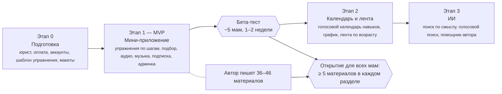

# «Дневник спокойного материнства»: техническое задание

27.10.2026

ТЗ на Telegram-бот с мини-приложением для мам детей 3–18 месяцев. MVP — мини-приложение с упражнениями, интерактивом, аудио и подпиской. В версии учтены ответы заказчицы от 26–27.10.2026. Документ ждёт ответов на оставшиеся вопросы (раздел 18) и открытых решений (раздел 17).

| Параметр | Значение |
| --- | --- |
| Версия | 2.0 (на согласование), с приложением: черновики юридических документов |
| Заказчица и автор | Вера Лукинова, канал [t.me/detimam_pro](https://t.me/detimam_pro) |
| Предыдущие версии | v1 (каркас), v2 (рабочая), v3 (1.0, до ответов заказчицы) |
| Технологии | На усмотрение исполнителя, с ограничениями из разделов 3, 11–13 |

**Как читать документ:**

- **Решено** — требование, исполнитель делает именно так.
- **Предложение** — вариант исполнителя по умолчанию. Если заказчица не возразит, он становится решением.
- **Решение требуется** — без ответа заказчицы (или юриста) этот пункт не разрабатывается. Все такие пункты собраны в разделе 17.

**Что изменилось по сравнению с версией 1.0:**

- **MVP — мини-приложение.** Это основной интерфейс мамы уже на этапе 1. Бот отвечает за вход, согласие, уведомления и голос.
- **Основной формат — упражнения.** После разговора автора с мамами: мамы тревожные, длинные тексты читать не хотят, им нужны упражнения, картинки и интерактив. Упражнение показывается по шагам с картинками, статьи короткие.
- **Подписка на закрытые материалы** закладывается в этап 1. Курсы и книги на ЛитРес — внешние ссылки. Консультации — только ссылка, без продаж.
- **Аудиопрактики** и плеер в приложении.
- **Голосовой календарь навыков:** модель данных — этап 1, запись голосом и график — этап 2, после решения юриста.
- **Раздел «Потешки и музыка»** с Яндекс Музыкой.
- **Словарь тегов** утверждён заказчицей, добавлен справочник навыков.
- **Контент:** новые материалы пишутся в Яндекс Документах и загружаются в админку файлом .docx.
- **Канал и бот — один медиапродукт:** все посты канала переносятся, новые подтягиваются автоматически (9.9).
- **Роль редактора убрана:** в админке работает только автор.
- **Окно согласий:** все согласия в одном окне с галочками. Мама принимает всё сразу или отмечает только то, что считает важным (8.9).

## Содержание

0. [Что нужно для старта разработки](#0-что-нужно-для-старта-разработки)
1. [Суть проекта](#1-суть-проекта)
2. [Приоритеты](#2-приоритеты)
3. [Правила, которые не нарушаются](#3-правила-которые-не-нарушаются)
4. [Роли](#4-роли)
5. [Аудитория и возраст ребёнка](#5-аудитория-и-возраст-ребёнка)
6. [Бот](#6-бот)
7. [Лента по возрасту](#7-лента-по-возрасту)
8. [Мини-приложение](#8-мини-приложение)
9. [Материалы и управление контентом](#9-материалы-и-управление-контентом)
10. [Поиск, ИИ, голос и календарь навыков](#10-поиск-ии-голос-и-календарь-навыков)
11. [Данные](#11-данные)
12. [Юридические вопросы](#12-юридические-вопросы)
13. [Нефункциональные требования](#13-нефункциональные-требования)
14. [Организационные требования](#14-организационные-требования)
15. [Этапы](#15-этапы)
16. [Приёмка](#16-приёмка)
17. [Решения](#17-решения)
18. [Вопросы заказчице](#18-вопросы-заказчице)
19. [Термины](#19-термины)

[Приложение. Юридические шаблоны](#приложение-юридические-шаблоны)

## 0. Что нужно для старта разработки

Разработка этапа 1 начинается, когда от заказчицы получено:

- [ ] Ответы на вопросы раздела 18, без которых не начать: 1 (оператор), 3 (аккаунты), 4–5 (подписка), 7 (картинки к упражнениям), 16 (дизайн).
- [ ] Решения из раздела 17 со сроком «до этапа 0» и «до этапа 1».
- [x] Черновики юридических документов: согласия, политика, оферта, пользовательское соглашение, тексты экранов ([Приложение](#приложение-юридические-шаблоны)). Экспертиза юриста не блокирует начало разработки, но нужна до бета-теста (раздел 12).
- [ ] Способ приёма оплаты, проверенный по актуальным правилам Telegram (Р21).
- [ ] Утверждённые словарь тегов и справочник навыков (9.6, 9.7).
- [ ] Шаблон упражнения и 3–5 готовых упражнений-образцов с картинками (9.2).
- [ ] Макеты главных экранов мини-приложения (8, Р13).
- [ ] Аккаунты на имя заказчицы: бот в BotFather, хостинг, домен, платёжный сервис (14).
- [ ] Согласованные сроки и бюджет этапа 1 (14).

## 1. Суть проекта

Telegram-бот с мини-приложением для мам детей от 3 до 18 месяцев. Внутри авторские упражнения, короткие статьи и практики (в том числе аудио), разложенные по возрасту ребёнка. Это не справочник и не ИИ-советчик, а спокойный голос одного автора.

Формат определён разговором автора с мамами. Мамы тревожные и запуганные интернетом, длинные тексты читать не хотят, им нужны **упражнения, картинки и интерактив**. Поэтому основной интерфейс — мини-приложение, а основной формат — короткое упражнение с картинками по шагам.

**Главный принцип: материалы автора — основа. Всё остальное (приложение, ИИ, голос, календарь) только помогает маме быстрее до них добраться.**

**Модель проекта:** бесплатные материалы дают охват и доверие, платная подписка открывает закрытые материалы, курсы и книги автора — внешние ссылки, консультации — только ссылка.

## 2. Приоритеты

Если бюджет или время ограничены, функции режутся снизу вверх. Пункты 1–3 не режутся.

| Приоритет | Что | Зачем |
| --- | --- | --- |
| 1 | Материалы автора (упражнения, статьи, практики, аудио) + удобное управление ими | Это ценность проекта |
| 2 | Мини-приложение: упражнения по шагам, подбор «Что уже умеет малыш?», аудиоплеер | Формат, который нужен мамам |
| 3 | Бот: вход, согласие, кнопка приложения | Вход и безопасность данных |
| 4 | Подписка на закрытые материалы | Доход |
| 5 | Голосовой календарь навыков | Удержание и функция, которой нет у других |
| 6 | Лента по возрасту | Возвращает маму |
| 7 | Поиск по смыслу, голосовой поиск, помощник автора | Удобство |

## 3. Правила, которые не нарушаются

1. ИИ **ничего не пишет маме от себя**. Он находит материалы автора и распознаёт голосовые записи календаря. Всё, что мама читает, — тексты автора или шаблонные фразы, утверждённые автором.
2. Нет режима «ответь в стиле автора» и пересказа материалов своими словами. При сборке статей из постов канала (9.9) ИИ только группирует и упорядочивает текст автора и не дописывает своего.
3. Бот и приложение не заменяют врача и не ставят диагнозы. Это сказано в согласии и под каждым материалом.
4. **Никаких норм и сравнений.** Календарь, график и подбор упражнений показывают только записи самой мамы. Нет «отставания», «уже должен», сравнения с другими детьми и со сроками.
5. Минимум данных. Любое новое поле данных требует отдельного решения заказчицы и обновления текста согласия (с новой версией согласия, см. 6.6).
6. Тексты и аудио автора, запросы и записи мам не передаются на обучение внешних моделей. Это требование к любому выбранному сервису, и оно подтверждается его договором или условиями.
7. Все сервисы, которые обрабатывают данные мам (хранилище, поиск, распознавание речи, ИИ), расположены на территории РФ. Исключения: сам Telegram и платёжный механизм Telegram, если он будет выбран (см. 12, Р21).

## 4. Роли

- **Мама** — пользуется приложением, слушает практики, ведёт календарь навыков, подписывается на ленту и подписку. Под «мамой» понимается любой взрослый, который ухаживает за ребёнком.
- **Автор** — это и есть заказчица. В админке работает одна. Пишет материалы в Яндекс Документах и загружает их в админку, управляет подпиской, лентой, ссылками, словарями, «красными словами» и текстами бота, смотрит обезличенную сводку.
- **Исполнитель** — разработка, запуск и сопровождение. Не меняет тексты автора. Исключения: загрузка стартового контента и настройка импорта канала (9.9). Публикует материал только автор.

## 5. Аудитория и возраст ребёнка

**Решено:**

- Возрастные разделы считаются в **полных месяцах** и включают нижнюю границу, но не верхнюю:
    - «3–6 месяцев»: от 3 полных месяцев до 6;
    - «6–9 месяцев»: от 6 до 9;
    - «9–12 месяцев»: от 9 до 12;
    - «12–18 месяцев»: от 12 до 18.
- Ребёнку ровно 6 месяцев — это раздел «6–9».
- У материала возраст «от» и «до» задаётся в полных месяцах. Материал показывается во всех разделах, с которыми пересекается его диапазон. Например, упражнение «4–9» попадает в «3–6» и «6–9».
- Разделы доступны всем независимо от того, указан ли возраст ребёнка. Возраст нужен ленте, календарю навыков и подсказке «ваш раздел» (см. 6.3).
- На старте приложением пользуются около 5 мам (бета-тест), затем аудитория растёт.

**Предложение:**

- **Ребёнку меньше 3 месяцев или мама ещё беременна.** Вход не закрываем. Показываем текст автора «Основные материалы начинаются с 3 месяцев, а пока вам может помочь „Спокойная мама“». Лента начинается автоматически, когда ребёнку исполняется 3 месяца.
- **Ребёнку исполнилось 18 месяцев.** Лента присылает прощальное сообщение автора и отключается. Доступ к материалам, закладкам и календарю сохраняется.
- **Один ребёнок на маму.** Для второго ребёнка мама меняет дату в настройках, а календарь предлагает начать заново или сохранить старые записи.
- Тексты пишутся в нейтральной форме, где это возможно, в том числе в окне согласий (8.9). Женский род («я согласна», «ознакомлена») — если автор так решит: основная аудитория — мамы.

## 6. Бот

Бот — вход в проект: согласие, кнопка приложения, уведомления и голос. Основная работа мамы идёт в мини-приложении.

### 6.1. Сценарий входа

1. **Приветствие.** /start → текст о проекте и авторе, ссылка на пользовательское соглашение → кнопка «Начать», которая открывает мини-приложение. Пока включён закрытый режим разработки (14), первой строкой идёт дисклеймер бета-версии.
2. **Окно согласий (8.9).** Одно окно в мини-приложении: мама нажимает «Принять всё» или отмечает галочками то, что считает важным. Без основного согласия на обработку данных дальше не пройти, и ничего не записывается.
3. **Готово.** В приложении открывается главная, в чате появляется главное меню бота.

Если у человека нет действующего основного согласия (нет записи или устарела версия), любое действие, включая старые кнопки и ссылки, ведёт в окно согласий.

### 6.2. Главное меню

- «Открыть приложение» — главная кнопка, она же кнопка меню рядом с полем ввода;
- «Записать навык» (голосом, этап 2, см. 10.4);
- «Лента» (подписка, пауза, отписка; этап 2);
- «Помощь» (как пользоваться, ссылки автора);
- «Настройки» (возраст ребёнка, время ленты, отзыв согласия).

### 6.3. Возраст ребёнка

- Дата спрашивается **не при входе**, а только когда она нужна:
    - при подписке на ленту;
    - при включении календаря навыков;
    - по желанию в настройках (тогда в приложении подсвечивается «ваш раздел»).
- Мама выбирает месяц и год рождения кнопками. Точная дата и имя не спрашиваются.

### 6.4. Свободный текст и голос в чате

- **Текстовое сообщение** без команды = поисковый запрос (см. 10.1). Бот отвечает ссылками на материалы в приложении.
- **Голосовое сообщение** (с этапа 2): бот распознаёт речь, показывает текст и кнопки «Записать в календарь», «Найти материалы», «Исправить». До этапа 2 бот отвечает: «Голосовые пока не поддерживаются».
- **Фото, файлы, стикеры** → короткий ответ автора «Я понимаю только текст и голос» и кнопка «Открыть приложение».
- Любой текст и распознанный голос сначала проверяется на «красные слова» (10.3).

### 6.5. Отзыв согласия

- Доступен всегда: «Настройки» → «Отозвать согласие» и команда /revoke, а также в настройках приложения.
- **Подтверждение:** «Все ваши данные, закладки, календарь и подписка на ленту будут удалены без возможности восстановления. Удалить?» → «Да, удалить» / «Отмена».
- Если у мамы оплачена подписка, бот дополнительно предупреждает, что доступ к закрытым материалам прекратится. Возврат денег — по правилам оферты.
- После подтверждения данные пользователя физически удаляются (см. 11.5), рассылка прекращается. Бот отправляет последнее сообщение: «Данные удалены. Если захотите вернуться, нажмите /start».
- **Повторный /start** проходит вход с нуля, как у нового человека.
- Telegram не позволяет боту удалить старые сообщения в чате. Переписка остаётся у мамы, и она может удалить её сама. Это указывается в согласии и в сообщении об удалении.

### 6.6. Версии согласия

- Каждый текст согласия имеет номер версии. У пользователя хранится версия, которую он принял. Каждое согласие из окна согласий (8.9) — отдельное, со своей версией и временем.
- **Решение требуется** (с юристом, Р8): при существенном изменении текста все пользователи проходят повторное согласие при следующем действии. Предложение: существенность отмечает автор галочкой при публикации новой версии.

### 6.7. Команды

- Команды: /start, /app, /help, /settings, /revoke.
- **Решено:** кнопки «Написать автору» нет. Ссылки на консультации, курсы и книги — в разделе «Полезное» (8.7) и в /help.

### 6.8. Тексты бота и приложения

Все тексты интерфейса пишет автор: приветствие, согласие, ошибки, заглушки, «такой статьи пока нет», «если не получается», экстренный текст, подтверждения календаря, прощальное сообщение ленты, описание и аватар бота. Исполнитель передаёт **полный список текстов** с черновиками на этапе 1. Автор правит их в админке без разработчика.

## 7. Лента по возрасту

Делается на этапе 2.

**Решено:**

- Подписка на ленту добровольная, с отдельным согласием на рассылку: галочка в окне согласий (8.9) или позже кнопка «Подписаться на ленту» в боте или приложении.
- При подписке спрашиваются месяц и год рождения ребёнка (если ещё не указаны) и удобное время.
- Лента присылает **анонс**: картинка, название, 2–3 строки, кнопка «Открыть в приложении».
- Лента присылает только материалы, **доступные маме**: бесплатные или входящие в её подписку.
- **Порядок:** материалы текущего возраста с отметкой «участвует в ленте», по полю «порядок», которые этой маме ещё не отправлялись.
- **Смена возраста** определяется автоматически по дате рождения. Неотправленные материалы прошедшего возраста больше не присылаются.
- **Материалы возраста закончились:** лента молчит до следующего возраста. Никаких повторов.
- Один материал не приходит одной маме дважды, в том числе после перезапуска сервера.

**Предложение (окончательно решается вопросом 14):**

- Частота: **2 раза в неделю**, автор может изменить её в админке.
- Время: мама выбирает «утро (9–11)», «день (13–15)» или «вечер (19–21)». Часовой пояс по умолчанию московский, его можно поменять в настройках.
- **Тихие часы:** с 22:00 до 8:00 по времени мамы ничего не отправляется.
- **Пауза:** на 1 неделю, 2 недели или месяц, затем лента возобновляется сама с предупреждением за сутки.

**Решение требуется (Р6):** разовые рассылки автора («вышел курс», «эфир в четверг»). Это реклама: нужно отдельное согласие на рекламные сообщения. Предложение: на старте не делать.

## 8. Мини-приложение

Мини-приложение — MVP и основной интерфейс мамы с этапа 1. Открывается из бота. Сервер проверяет подлинность запроса от Telegram (подпись данных запуска) и наличие действующего основного согласия. До основного согласия приложение показывает только окно согласий (8.9) и не отдаёт материалы.

### 8.1. Экраны

1. **Главная** — выбор возраста (подсвечен «ваш раздел»), кнопка «Что уже умеет малыш?», «Продолжить», «Новое от автора».
2. **Раздел возраста** — вкладки «Упражнения» и «Статьи». Карточка: картинка, название, тег, время выполнения или чтения, замок у закрытого материала.
3. **Упражнение** — по шагам с картинками (8.2).
4. **Статья** — короткий текст с картинками, кнопка «В закладки».
5. **«Что уже умеет малыш?»** — подбор упражнений (8.3).
6. **Спокойная мама** — телесные и психологические практики, аудиоплеер (8.4), отметка «выполнено».
7. **Потешки и музыка** — плейлисты автора (8.5).
8. **Календарь навыков** — записи и график (10.4, этап 2).
9. **Поиск** — строка поиска, результаты — материалы автора.
10. **Полезное** — ссылки автора (8.7).
11. **Подписка** — что входит, цена, оплата, статус и срок (8.6).
12. **Настройки** — возраст ребёнка, лента, закладки, календарь (включить, выключить, удалить записи), «Мои согласия» (8.9), отзыв согласия с тем же подтверждением, что в боте.
13. **Окно согласий** — при первом входе и в настройках как «Мои согласия» (8.9).

Под каждым материалом подпись «Материалы автора. Не заменяет консультацию врача».

### 8.2. Упражнение по шагам

- Упражнение показывается как короткие слайды, которые листаются свайпом: на каждом шаге картинка (или анимация, короткое видео — Р25) и 1–3 строки.
- После последнего шага — блок «Как понять, что получается» и две кнопки: «Получилось» и «Пока не получается».
- «Получилось» ставит отметку «выполнено» и предлагает следующее упражнение раздела.
- «Пока не получается» показывает текст автора («это нормально, у каждого свой темп») и облегчённый вариант, если автор его указал.
- Если автор заполнил блок «Когда показать врачу», он показывается спокойным текстом в конце упражнения.
- Кнопки «В закладки» и «Слушать» (если у упражнения есть аудио).

### 8.3. Подбор «Что уже умеет малыш?»

- Мама отмечает навыки из справочника (9.7), которые малыш уже освоил.
- Приложение показывает упражнения, у которых выполнено условие «нужно уметь», а навык «ведёт к» ещё не отмечен.
- Если подходящих упражнений нет, показывается текст автора и упражнения раздела по возрасту.
- **Отметки не сохраняются** и живут только во время сеанса. Исключение — мама включила календарь навыков: тогда отметки можно записать в календарь отдельной кнопкой (10.4).
- Подбор не оценивает ребёнка и не говорит, что он «отстаёт» (правило 3.4).

### 8.4. Аудиоплеер

- Воспроизведение, пауза, перемотка, скорость 1× / 1,25×, продолжение с места остановки.
- Работа при заблокированном экране внутри Telegram не гарантируется. Поэтому у каждого аудио есть кнопка «Прислать в чат»: бот присылает файл, и он играет как обычное аудио Telegram, в том числе в фоне.
- Закрытые аудио (по подписке) не присылаются в чат без подписки.

### 8.5. Потешки и музыка

- Автор собирает плейлисты (потешки, стихи, колыбельные, музыка) в Яндекс Музыке. В админке хранятся только ссылки, файлы музыки проект не хранит.
- **Предложение (Р24):** встроить официальный виджет Яндекс Музыки. В начале этапа 1 исполнитель проверяет его на прототипе: iPhone и Android, внутри Telegram, без входа в Яндекс. Если виджет играет только фрагменты или просит войти, вместо него ставится кнопка «Слушать в Яндекс Музыке», которая открывает плейлист в их приложении.
- Виджет передаёт данные Яндексу. Это упоминается в политике обработки данных.

### 8.6. Подписка и закрытые материалы

**Решено:**

- У каждого материала есть поле «Доступ»: «бесплатно» или «по подписке».
- Закрытые материалы видны в списках с замком и коротким описанием. При открытии без подписки — экран «Подписка» с тем, что входит, и ценой.
- Доступ к закрытым материалам проверяется на сервере, в том числе по прямым ссылкам и в ленте.
- Подписка действует до конца оплаченного срока. Перед окончанием бот присылает напоминание за 3 дня (если мама согласилась на уведомления).
- Доступ открывается не позже чем через 1 минуту после подтверждения оплаты. Сбой не приводит ни к потере оплаты, ни к двойному списанию.
- Автор в админке видит число активных подписок. Платёжные данные (номер карты и т.п.) проект не получает и не хранит.

**Решение требуется:**

- **Способ оплаты (Р21).** По имеющимся данным, Telegram требует продавать цифровые товары и подписки внутри ботов и мини-приложений за Telegram Stars, а вывод Stars в рубли из РФ затруднён. Оплата через внешний платёжный сервис по ссылке может нарушить правила Telegram и привести к блокировке бота. До начала этапа 1 исполнитель проверяет актуальные правила Telegram, а заказчица с юристом выбирает способ.
- **Что закрыто и цена (Р22, вопросы 4–5):** целые возрастные разделы, часть упражнений, аудиопрактики; период подписки; пробный период.

### 8.7. Полезное

- Ссылки автора: консультации, курсы, книги на ЛитРес. Ведутся в админке.
- **Решено:** внутри приложения консультации не продаются и не рекламируются, только ссылка (автор не может предлагать их на основной работе).

### 8.8. Общие требования

- Приложение читает те же материалы, что и бот. Контент хранится в одном месте и правится один раз.
- Прямые ссылки из бота и ленты на конкретный материал.
- Светлая и тёмная тема Telegram. Крупный шрифт по умолчанию и переключатель «крупнее».
- Работает внутри Telegram на iPhone и Android. Открытие по ссылке в обычном браузере показывает «Откройте через бот».
- **Решение требуется (Р13):** кто делает дизайн (цвета, шрифты, иллюстрации, логотип). Макеты главных экранов согласуются **до начала этапа 1**, потому что приложение теперь входит в MVP.

### 8.9. Окно согласий

**Решено (27.10.2026):** все согласия мама даёт в одном окне. Она может принять всё сразу или отметить галочками только то, что сама считает важным.

| Пункт в окне | Обязательно | Текст согласия |
| --- | --- | --- |
| **Обработка персональных данных** — без этого приложение не работает | да | основное согласие |
| **Лента** — присылать упражнения по возрасту малыша | нет | согласие на рассылку |
| **Календарь навыков** — хранить записи о навыках малыша | нет | согласие на календарь, с этапа 2 |
| **Новости автора** — анонсы курсов и эфиров | нет | согласие на рекламу, только если Р6 «да» |

У каждого пункта галочка, одна строка пояснения и ссылка «Текст согласия». Под пунктами ссылка на политику обработки данных. Кнопки:
- «Принять всё»;
- «Продолжить с выбранными» — активна, когда отмечен первый пункт;
- «Не сейчас».

**Правила:**

- Галочки по умолчанию сняты.
- «Принять всё» отмечает только пункты, показанные в окне, и сразу продолжает.
- Необязательные пункты не влияют на доступ к материалам.
- В окне только функции, которые уже работают: календарь появляется с этапа 2, новости автора — только если Р6 «да». Когда запускается новая функция, мама видит её в «Мои согласия» и получает предложение при первом использовании.
- Каждая галочка — отдельное согласие со своим текстом, версией и временем (6.6). Пользовательское соглашение и оферта в окно не входят: соглашение принимается в приветствии, оферта — при оплате.
- Если отмечена лента, после окна спрашиваются месяц и год рождения ребёнка и удобное время (7).
- «Не сейчас» без первой галочки показывает текст «Без согласия на обработку данных приложение не работает. Вы можете вернуться в любой момент». Данные не записываются.
- То же окно доступно в настройках как **«Мои согласия»**. Снять галочку — значит отозвать это согласие. Если при этом удаляются данные (например, записи календаря), мама подтверждает удаление. Снятие первой галочки — полный отзыв согласия (6.5).

**Решение требуется (Р27, юрист):** достаточно ли кнопки «Принять всё» для отдельных согласий, особенно на календарь навыков (возможно, специальная категория данных) и на рекламу. Если нет, эти пункты исключаются из «Принять всё» и отмечаются только своей галочкой. Остальное окно не меняется.

## 9. Материалы и управление контентом

### 9.1. Типы материалов

| Тип | Что это | Где показывается |
| --- | --- | --- |
| Упражнение | Основной формат: 2–6 шагов с картинками | Возрастные разделы, подбор, лента |
| Статья | Короткий текст с картинками. Предложение: до 2 000 знаков | Возрастные разделы, лента |
| Телесная практика | Практика для мамы, текст и (или) аудио | «Спокойная мама» |
| Психологическая практика | Практика для мамы, текст и (или) аудио | «Спокойная мама» |

### 9.2. Шаблон упражнения

- Название, возраст от/до, теги, навыки «ведёт к» и «нужно уметь» (из справочника 9.7, второе необязательно).
- 2–6 шагов: картинка (анимация, видео — Р25) и 1–3 строки на каждый шаг.
- «Как понять, что получается» — 1–2 строки.
- «Если не получается» — успокаивающий текст и облегчённый вариант (необязательно).
- «Когда показать врачу» (необязательно).
- Время выполнения, аудио (необязательно), доступ (бесплатно / по подписке).

Исполнитель готовит шаблон в Яндекс Документах. Документ, заполненный по шаблону, загружается в админку файлом .docx и автоматически раскладывается по полям. Автор проверяет результат перед публикацией.

### 9.3. Поля материала

| Поле | Обязательно | Примечание |
| --- | --- | --- |
| Название | да |  |
| Тип | да | упражнение / статья / телесная практика / психологическая практика |
| Текст или шаги | да | шаги — для упражнений, единый формат разметки (9.5) |
| Картинки | да для упражнений | по одной на шаг, плюс обложка |
| Возраст от / до, мес. | да | для практик «Спокойной мамы» не заполняется |
| Теги | да, 1–3 | из словаря (9.6) |
| Навыки «ведёт к» / «нужно уметь» | для упражнений | из справочника (9.7) |
| «Как понять, что получается», «Если не получается», «Когда показать врачу» | для упражнений | второе и третье необязательны |
| Аудио | нет | обязательно для аудиопрактик |
| Доступ | да | бесплатно / по подписке |
| Порядок | да | для списков и ленты |
| Анонс | да для ленты | 2–3 строки |
| Участвует в ленте | да/нет |  |
| Статус | да | черновик / опубликовано / запланировано / в архиве |
| Дата публикации | для «запланировано» |  |
| См. также | нет | ссылки на 1–3 других материала |
| Источники | для собранных из канала | ссылки на исходные посты (9.9) |
| Время | — | считается автоматически или задаётся автором для упражнения |

### 9.4. Требования к редактированию

**Решено:** админка, а не таблица (Р1). Картинки по шагам, аудио, предпросмотр и история правок в таблице не сделать.

- Автор сама добавляет и правит материалы без разработчика.
- **Загрузка .docx** из Яндекс Документов по шаблону (9.2).
- Загрузка картинок, анимаций и аудио. Предложение по форматам: картинки JPG/PNG/WebP, анимации GIF или MP4 без звука, аудио MP3/M4A.
- **Предпросмотр** перед публикацией: как материал выглядит в приложении и анонс в боте.
- **Тестовая отправка** анонса себе в бот.
- **Черновики** и **отложенная публикация** на дату и время.
- **История правок** с возможностью вернуть предыдущую версию.
- **Архив вместо удаления.** Материал в архиве пропадает из списков и ленты. В закладках мам он показывается как «Материал больше недоступен».
- Правка видна в приложении и боте не позже чем через 5 минут, без перезапуска.
- В той же админке: тексты бота (6.8), «красные слова» и экстренный текст (10.3), словарь тегов, справочник навыков, ссылки «Полезного», плейлисты, частота ленты, настройки подписки.
- Сводка для автора: см. 11.3.

### 9.5. Формат текста

- Один формат разметки для приложения и анонсов: жирный, курсив, ссылки, списки, подзаголовки, картинки.
- Таблицы, цвет текста и сложная вёрстка не поддерживаются.
- Исполнитель готовит **памятку автору на одну страницу** вместе с шаблоном упражнения.

### 9.6. Словарь тегов

**Решено (заказчица, 26.10.2026), с правками исполнителя — ждут подтверждения (вопрос 9):**

Сон, Прикорм, Плач, Развитие, Психология, Усталость мамы, Здоровье, Массаж, Гимнастика и упражнения, Ползание.

- «Телесные практики» убраны из тегов: это уже тип материала (9.1).
- «Здоровье» — обычный тег. «Красные слова» — отдельный список (10.3), тег их не заменяет.
- «Ползание» одновременно и тег, и навык в справочнике (9.7), они связаны.
- Свободный ввод тегов при редактировании не допускается. Словарь ведёт автор.

### 9.7. Справочник навыков

**Решено (заказчица, 26.10.2026):** держит голову, улыбка, гуление, переворот, опора на ладони, ползание, сел, встал у опоры, первые шаги, пошёл уверенно, лепет, указательный жест.

- Справочник используется в трёх местах: календарь навыков (10.4), подбор упражнений (8.3), связь «навык → материалы».
- Справочник ведётся отдельно от тегов, чтобы не засорять поиск.
- У навыка нет «нормального срока». Справочник — просто список, без возрастных норм (правило 3.4).
- Автор может добавлять навыки в админке.

### 9.8. Объём к запуску

**Предложение:** 36–46 материалов:
- по 6–10 упражнений на каждый возрастной раздел;
- по 2–3 короткие статьи на раздел;
- по 5–6 практик каждого вида в «Спокойной маме».

Раздел, где меньше 5 материалов, выглядит пустым: такой раздел не показывается до наполнения (Р11). На год вперёд ориентир 100+ материалов.

Из канала переносится около 15 постов, после сборки это примерно 10–12 статей (9.9). Остальное автор пишет сама, по её оценке 5–7 материалов в день, поэтому стартовый объём набирается параллельно с этапом 1. Посты канала — в основном статьи, поэтому упражнения нужно писать заново. **Узкое место — картинки к упражнениям:** нужно 4–6 картинок на каждое упражнение (Р25, вопрос 7).

### 9.9. Канал и импорт постов

**Решено (27.10.2026):**

- **Канал [t.me/detimam_pro](https://t.me/detimam_pro) и бот с приложением — один медиапродукт** (Р19): один автор, один бренд, одна база материалов. Канал — живая лента автора и источник новых материалов. Приложение — библиотека по возрасту с упражнениями, интерактивом и подпиской.
- **Все существующие посты канала переносятся** в базу материалов (Р17).
- **Все новые посты подтягиваются автоматически** (Р18). Бот добавлен в канал администратором. Каждый новый пост сразу попадает в админку, в раздел «Входящие из канала», и проходит нарезку и сборку (шаги 3–5). В приложении материал появляется после утверждения автором одной кнопкой: правило «публикует только автор» сохраняется.

**Связь канала и приложения:**

- В приложении и в /help — ссылка «Канал автора».
- В канале — закреплённый пост со ссылкой на бот.
- **Предложение:** под постом канала, который стал материалом, бот добавляет кнопку «Открыть в приложении». Для этого боту нужно право редактировать сообщения в канале.
- Пост и материал из него связаны. Если автор правит пост в канале, в админке появляется отметка «пост изменён», и автор решает, обновлять ли материал.
- Канал публичный, поэтому всё, что опубликовано в нём, доступно бесплатно. Закрывать подпиской имеет смысл материалы, которых нет в канале (Р22).

**Перенос существующих постов (этап 1):**

1. **Выгрузка.** Автор выгружает историю канала через Telegram Desktop в JSON с картинками. Служебные посты отбрасываются автоматически, но видны автору в списке «пропущено».
2. **Карусели.** Автор присылает исходные тексты. Если их нет, текст распознаётся с картинок и помечается «требует проверки».
3. **Нарезка.** Пост делится на смысловые блоки: подзаголовок вместе с его абзацами.
4. **Предложение статей.** ИИ группирует блоки по темам, находит повторы, предлагает план и анонс.
5. **Работа автора.** Автор видит источник каждого блока, переставляет, правит, утверждает или отклоняет.

**Новые посты (этап 1):** проходят шаги 3–5 автоматически сразу после публикации в канале. Карусели — как в шаге 2.

**Правила сборки:** ИИ не дописывает своих фраз и не переформулирует текст. Система подсвечивает любой текст, которого нет в исходных постах. У статьи сохраняются ссылки на посты.

## 10. Поиск, ИИ, голос и календарь навыков

### 10.1. Поиск

- **Этап 1:** поиск по словам в названиях, тегах и текстах материалов.
- **Этап 3:** поиск по смыслу. Мама пишет своими словами («не засыпает без груди», «устала и срываюсь»), система возвращает 1–3 материала автора. **Своего текста нет.**
- **Решено:** в поиске для мамы не используется генеративная модель. Подбор идёт только по сходству запроса с материалами (векторный поиск).
- Если подходящего материала нет: «Такой статьи пока нет» и кнопка «Хочу материал на эту тему» (см. 11.2).
- Закрытые материалы в результатах показываются с замком.
- **Ограничение:** до 30 поисковых запросов в день на маму. Автор задаёт месячный потолок расходов на ИИ-сервисы. Когда он достигнут, поиск переключается на обычный по словам.
- **Критерий качества для приёмки поиска по смыслу:** из 30 тестовых запросов автора в 25 ожидаемый материал должен быть в тройке результатов.

### 10.2. Голосовой ввод

**Решено:**

- Голос принимается **голосовым сообщением в бот**. Микрофон внутри мини-приложения добавляется, только если он проверен на iPhone и Android (Р3).
- Голос используется для двух задач: запись в календарь навыков (этап 2) и поиск (этап 3). Мама выбирает задачу кнопкой после распознавания (6.4).
- Распознанный текст **всегда показывается маме** перед действием.
- Аудио удаляется сразу после распознавания. Текст поискового запроса не сохраняется. Для календаря сохраняется только результат (дата, навык, статус), без аудио и без текста.
- Распознавание выполняется сервисом в РФ с отключённым сохранением данных на его стороне и без использования их для обучения.
- Ограничение длины голосового: 60 секунд.

### 10.3. Страховка для тревожных запросов

- Список «красных слов» и фраз задаёт и пополняет автор в админке. Исполнитель готовит стартовый список из 50+ слов и фраз, автор его утверждает.
- Слово находится **с учётом форм** (температура, температурит, температуры) и типичных опечаток. Лишнее срабатывание допустимо, пропуск — нет.
- Проверка выполняется **до** любого действия: для поиска в приложении, текста и голоса в боте, записей календаря.
- На такой запрос приходит фиксированный текст автора, подбор материалов и запись в календарь не выполняются. Текст обязательно содержит номера **103** (скорая с мобильного) и **112**. Предлагаемое начало: «Если ребёнку сейчас плохо, звоните 103 или 112».
- Делается на этапе 1, потому что поиск входит в MVP.

### 10.4. Голосовой календарь навыков

**Решено (заказчица, 26.10.2026):** модель данных и справочник навыков — этап 1, запись и график — этап 2. Сбор данных включается только после решения юриста (Р23).

**Как работает:**

1. Мама нажимает «Записать навык» в боте и наговаривает, например: «15 ноября, сегодня пополз, но пока неуверенно».
2. Система распознаёт речь, проверяет «красные слова» и извлекает три значения:
    - **дата** — в том числе «сегодня», «вчера», «15 ноября»;
    - **навык** — из справочника (9.7);
    - **статус** — «Старт навыка» или «Навык сформирован».
3. Бот показывает шаблонный текст «Записала: 15.11 — ползание — старт навыка» с кнопками «Верно», «Исправить», «Отмена». **Без «Верно» ничего не сохраняется.**
4. Если навык или дата не распознаны, бот предлагает выбрать их кнопками.
5. После сохранения бот предлагает материалы автора по этому навыку.

**Ещё:**

- Запись можно добавить и в приложении кнопками, без голоса.
- **График в приложении:** временная шкала по навыкам, от «старта» до «сформирован». Без норм, без сравнения с другими детьми и сроками, без слов «отставание» и «рано/поздно» (правило 3.4).
- Мама может править и удалять записи, выключить календарь и удалить все его данные отдельно от отзыва согласия.
- Календарь включается **отдельным согласием**: галочкой в окне согласий (8.9) или при первом использовании.
- Технически это не векторный поиск, а извлечение данных по фиксированному справочнику. ИИ возвращает только структуру (дата, навык, статус), маме показывается шаблонный текст автора.

### 10.5. Помощник автора (мама его не видит)

Работает только в админке, этап 3. Здесь генеративная модель допустима, потому что её результат видит и утверждает только автор.

- Предлагает теги, навыки и черновик анонса по тексту материала.
- Подсказывает темы, которых не хватает (по данным 11.2 и пустым разделам).
- Проверяет черновик на опасные формулировки: диагнозы, дозировки, «не ходите к врачу», сравнение с нормами. Показывает предупреждения, но не запрещает публикацию.
- Собирает статьи из постов канала (9.9) — эта часть делается на этапе 1.

### 10.6. Выбор ИИ-сервисов

**Решение требуется (Р4):** конкретные сервисы для распознавания речи, извлечения данных календаря, поиска по смыслу и помощника автора.

| Задача | Нужно до |
| --- | --- |
| Сборка статей из канала, распознавание текста каруселей | этапа 1 |
| Распознавание речи и извлечение данных календаря | этапа 2 |
| Поиск по смыслу и помощник автора | этапа 3 |

Требования: расположены в РФ, запросы не сохраняются и не идут на обучение (подтверждается договором или условиями), стоимость укладывается в потолок из 10.1. Предложение: сравнить сервисы Яндекса (SpeechKit, YandexGPT, векторный поиск) и Сбера (SaluteSpeech, GigaChat) по цене и условиям.

### 10.7. Чего ИИ не делает

Не даёт советов, не пересказывает материалы, не оценивает развитие ребёнка и не делает выводов о нём, не хранит историю общения с мамой, не запоминает «личную историю материнства».

## 11. Данные

### 11.1. Что хранится с привязкой к пользователю

| Данные | Зачем | Когда появляется | При отзыве согласия |
| --- | --- | --- | --- |
| Telegram ID | узнать пользователя | при согласии | удаляется |
| Время и версия согласия | доказать согласие | при согласии | удаляется (журнал — Р10) |
| Согласие на ленту: да/нет, время | законность рассылки | при подписке на ленту | удаляется |
| Месяц и год рождения ребёнка | лента, календарь, «ваш раздел» | по необходимости (6.3) | удаляется |
| Настройки ленты: вкл/пауза, время суток, часовой пояс | рассылка | при подписке на ленту | удаляется |
| Список отправленных лентой материалов | без повторов | при рассылке | удаляется |
| Закладки, последний открытый материал | закладки, «Продолжить» | по действию мамы | удаляется |
| Отметки «выполнено» / «получилось» | прогресс | по действию мамы | удаляется |
| Согласие на календарь: да/нет, время, версия | законность календаря | при включении календаря | удаляется |
| Записи календаря: навык, дата, статус | календарь и график | по подтверждению мамы | удаляется |
| Подписка: статус, тариф, срок, идентификатор платежа | доступ к закрытым материалам | при оплате | см. 11.5 |
| Признак «бот заблокирован» | остановка рассылки | автоматически | удаляется |

### 11.2. Что хранится обезличенно

Без Telegram ID и без возможности связать с человеком:

- **Счётчики просмотров и прослушиваний:** материал, дата, число.
- **«Получилось» / «Пока не получается»** по каждому упражнению. Автор видит, какие упражнения даются трудно.
- **Темы «чего ищут, но нет».** По кнопке «Хочу материал на эту тему» мама выбирает тему из словаря тегов или «Другое». Хранится только счётчик «тема + дата». **Текст запроса не хранится** (альтернатива — Р2).
- Общие счётчики: подписанные на ленту по разделам, активные подписки, включённые календари.

### 11.3. Сводка для автора

Подписанные на ленту по возрастам, число активных подписок, популярные материалы и темы, трудные упражнения («пока не получается»), темы «чего ищут, но нет», пустые и маленькие разделы. Строится только из данных 11.2 и агрегатов. Отдельные мамы в сводке не видны.

### 11.4. Что не хранится

Имя, username, телефон, текст поисковых запросов, голос, текст голосовых записей календаря (только результат), отметки подбора «Что уже умеет малыш?» (без включённого календаря), точная дата рождения и имя ребёнка, данные о здоровье мамы или ребёнка, переписка с ботом, платёжные данные карты.

### 11.5. Удаление и сроки хранения

- **При отзыве согласия:** физическое удаление всего из 11.1, кроме записей об оплате.
- **Записи об оплате** хранятся столько, сколько требует налоговое законодательство, отдельно от остальных данных и без данных о ребёнке. Срок и состав уточняет юрист.
- **Календарь** мама может удалить отдельно, не отзывая согласие.
- **Резервные копии** хранятся не дольше **30 дней**. Удалённые данные исчезают из них по мере ротации.
- **Логи** не содержат Telegram ID в открытом виде, username, имён, текстов запросов и записей календаря. Хранятся не дольше 30 дней.
- **Неактивные пользователи** (Р9). Предложение: через 12 месяцев без действий данные удаляются автоматически, кроме записей об оплате.
- **Журнал отзывов** (Р10): нужен ли и в каком виде, решает юрист.

### 11.6. Что не делаем без отдельного решения

Дневник ребёнка (кроме календаря навыков по 10.4), календарь прививок, свободные заметки мамы, оценку настроения, память ИИ о маме, сообщения автору. Это данные о здоровье и состоянии, они меняют юридическую схему.

Календарь навыков — такое отдельное решение, принятое заказчицей 26.10.2026. Оформляется юристом (Р23).

## 12. Юридические вопросы

**Решено (27.10.2026):** юрист пока не привлекается. Исполнитель готовит черновики всех документов — они в [Приложении](#приложение-юридические-шаблоны), там же список вопросов юристу. Экспертиза проекта юристом проводится до бета-теста: с бета-теста бот уже обрабатывает данные реальных мам. До этого бот работает в закрытом режиме разработки (14): только исполнитель, автор и 1–3 знакомых, окно согласий показывает черновики с пометкой о бета-версии. Предложение (Р26): разбить экспертизу по этапам — к бета-тесту документы этапа 1, к этапу 2 согласие на календарь навыков и рассылку.

**До этапа 1:**

1. **Кто оператор персональных данных и продавец подписки** (ИП, самозанятая, ООО).
2. Согласие на обработку данных и опубликованная политика обработки персональных данных.
3. **Отдельное согласие на рассылку** (лента) и, если будут разовые рассылки, на рекламные сообщения.
4. **Оферта на подписку:** что входит, срок, продление, возврат.
5. **Чеки** по оплатам (онлайн-касса или «Мой налог» для самозанятой).
6. **Правила Telegram** для продажи цифровых товаров (Telegram Stars) и их совместимость с выбранным способом оплаты (Р21).
7. Нужно ли уведомление Роскомнадзора об обработке данных.
8. **Трансграничная передача через Telegram:** серверы Telegram за рубежом.
9. Месяц и год рождения ребёнка как данные несовершеннолетнего по согласию родителя.
10. Пользователи младше 18 лет: нужна ли проверка или оговорка.
11. Сроки хранения резервных копий, логов и записей об оплате.
12. Формулировка «не является медицинской консультацией».
13. Виджет Яндекс Музыки в политике обработки данных.
14. Фото реальных детей на картинках упражнений: согласия родителей (если будут фото).

**До этапа 2:**

15. **Календарь навыков:** являются ли записи о развитии ребёнка данными о здоровье, какое нужно основание и отдельное согласие (Р23).
16. Голосовые записи и их распознавание внешним сервисом.
17. Журнал отзывов согласия (Р10).

**На стороне автора:** ссылка на консультации допустима с учётом её основной работы — автор оценивает это сама.

## 13. Нефункциональные требования

**Скорость и надёжность**

| Действие | Допустимое время |
| --- | --- |
| Ответ на нажатие кнопки в боте | ≤ 2 с |
| Открытие приложения | ≤ 3 с |
| Открытие упражнения с картинками на мобильном интернете | ≤ 3 с |
| Начало воспроизведения аудио | ≤ 3 с |
| Результат поиска | ≤ 5 с |
| Распознавание голосового до 60 с | ≤ 10 с |
| Открытие доступа после оплаты | ≤ 1 мин |

- Картинки автоматически уменьшаются под экран телефона при загрузке в админку.
- Аудио воспроизводится потоком, без полной загрузки файла.
- Сервис работает с автоперезапуском. Целевая доступность 99% в месяц.
- Бот не падает, если мама заблокировала его: рассылка ей отключается автоматически.
- Рассылка идёт порциями в пределах ограничений Telegram и защищена от двойной отправки при перезапуске.
- Подтверждение оплаты обрабатывается повторно при сбое и не открывает доступ дважды.

**Нагрузка:** на старте около 5 мам (бета-тест). Архитектура рассчитывается на рост до 5 000 пользователей в первый год (Р14). При росте выше этого исполнитель заранее предупреждает об изменении стоимости хостинга.

**Мониторинг и резервное копирование**

- Ежедневное резервное копирование базы, картинок и аудио, хранение 30 дней. Восстановление проверяется до запуска.
- При падении, ошибках рассылки или оплаты уведомление приходит исполнителю (и по желанию автору) в Telegram.

**Безопасность**

- Вход в админку только по личной учётной записи с двухфакторной аутентификацией. Роли: автор (всё) и исполнитель (техническая поддержка, без изменения текстов).
- Журнал действий в админке: кто и когда изменил материал.
- Все ключи и токены хранятся вне кода.
- Закрытые картинки и аудио не отдаются по прямой ссылке без проверки подписки.

## 14. Организационные требования

**Решено (заказчица):**

- **Оплата разработки — по этапам**, отдельно за каждый.
- **Запуск как можно скорее:** цель — быстро занять нишу.
- **Цель первых 3 месяцев** — стабильно работающее решение без сбоев.
- **Метрики утверждены:** доля мам, подписанных на ленту, доля отписавшихся, число возвращающихся в неделю, популярные материалы. Плюс для подписки: число активных подписок.

**Требования:**

- **Все аккаунты оформлены на заказчицу:** бот в BotFather, хостинг, домен, ИИ-сервисы, платёжный сервис, репозиторий кода, почта для уведомлений. Исполнитель получает доступ, но не владеет ими.
- **Права на код** и все материалы проекта переходят заказчице. При завершении работ передаются инструкция по запуску и доступы.
- **Одна среда и закрытый режим разработки (решено 27.10.2026).** Разработка идёт сразу на боевом боте и боевом сервере, без отдельной тестовой среды. Пока идёт разработка, включён закрытый режим:
    - бот и приложение работают только для Telegram ID из **списка доступа** в админке: исполнитель, автор и 1–3 знакомых исполнителя, которые проверяют кнопки. Больше никого;
    - участники из списка — **обычные пользователи**: проходят окно согласий, получают всё, что получит мама, их данные записываются как у всех. По окончании закрытого тестирования эти данные удаляются (см. ниже);
    - всем остальным бот отвечает «Бот пока в разработке» со ссылкой на канал автора и ничего о них не записывает;
    - **дисклеймер бета-версии** показывается в приветствии, в /help, плашкой вверху приложения и над окном согласий (тексты — приложение, документ 07, раздел 0);
    - оплата работает только в тестовом режиме, если выбранный способ его поддерживает. Если не поддерживает, оплата выключена до бета-теста;
    - закрытый режим и плашка выключаются переключателями в админке.
- **Перед бета-тестом с мамами:** данные участников закрытого тестирования удаляются кнопкой «Удалить данные тестировщиков» в админке (с подтверждением), затем в список доступа добавляются ~5 мам. Плашка «Бета-версия» остаётся до открытия для всех.
- **Бета-тест:** после этапа 1 около 5 мам пользуются приложением 1–2 недели, автор собирает обратную связь.
- **Сопровождение после запуска** (Р15): предложение — 1 месяц гарантии на исправление ошибок после каждого этапа, затем договор поддержки.

## 15. Этапы

MVP — этап 1: мини-приложение со всеми материалами, интерактивом, аудио и подпиской. Каждый следующий этап добавляет функции к работающему продукту. Бот открывается для всех мам после бета-теста, когда в каждом показываемом разделе есть не меньше 5 материалов (Р11).

1. **Этап 0 (до разработки):** ответы на вопросы раздела 18, решения раздела 17 со сроком «до этапа 0» и «до этапа 1», документы юриста для этапа 1, проверка способа оплаты по правилам Telegram, аккаунты, словарь тегов и справочник навыков, шаблон упражнения и 3–5 образцов, макеты главных экранов, список текстов бота.
2. **Этап 1 (MVP, мини-приложение):**
    - бот: вход, согласие, отзыв, кнопка приложения, /help, текстовый поиск в чате;
    - мини-приложение: разделы по возрасту, упражнения по шагам с «Получилось / Пока не получается», короткие статьи, «Спокойная мама» с аудиоплеером, подбор «Что уже умеет малыш?», «Потешки и музыка», «Полезное», закладки, поиск по словам, «красные слова», настройки;
    - подписка: закрытые материалы и оплата;
    - админка: материалы, загрузка .docx, картинки и аудио, словари, ссылки, плейлисты, тексты бота, сводка;
    - модель данных календаря навыков (без сбора данных);
    - тестовая среда;
    - импорт канала: перенос всех постов и автоматическая подгрузка новых (9.9).
3. **Этап 2:** голосовой календарь навыков (запись, подтверждение, график) — после решения юриста; лента по возрасту.
4. **Этап 3:** поиск по смыслу, голосовой поиск, помощник автора.

Параллельно с этапом 1 автор пишет стартовые материалы по шаблону.

## 16. Приёмка

Работа принимается по сквозным проверкам. Каждая выполняется при приёмке того этапа, в котором появляется функция.

**Согласие и данные (этап 1)**

- [ ] 1. Без согласия нельзя попасть ни в меню бота, ни в мини-приложение, в том числе по старым кнопкам и ссылкам.
- [ ] 2. Окно согласий: галочки по умолчанию сняты; «Принять всё» отмечает только показанные пункты; без первой галочки дальше не пройти и ничего не записывается; снятие галочки в «Мои согласия» отзывает это согласие.
- [ ] 3. Отзыв согласия запрашивает подтверждение, удаляет данные из 11.1 (кроме записей об оплате) и прекращает рассылку. Повторный /start проходит вход с нуля.
- [ ] 4. Новая версия согласия, отмеченная как существенная, требует повторного согласия.
- [ ] 5. В базе нет данных из 11.4. В логах нет Telegram ID в открытом виде, username, имён и текстов запросов.
- [ ] 6. Данные и сервисы расположены на территории РФ (кроме Telegram и платёжного механизма Telegram, если он выбран).

**Контент и админка (этап 1)**

- [ ] 7. Автор без разработчика загрузила упражнение из .docx по шаблону, добавила картинки и аудио, посмотрела предпросмотр, отправила себе тест, запланировала публикацию, вернула прошлую версию и убрала материал в архив. Всё отобразилось в приложении не позже чем через 5 минут.
- [ ] 8. Материал «4–9 месяцев» виден в разделах «3–6» и «6–9».
- [ ] 9. Автор изменила тексты бота, «красные слова», ссылки «Полезного» и плейлисты без разработчика.

**Мини-приложение (этап 1)**

- [ ] 10. Упражнение листается по шагам с картинками на iPhone и Android, в светлой и тёмной теме.
- [ ] 11. «Пока не получается» показывает текст автора и облегчённый вариант, «Получилось» ставит отметку и предлагает следующее упражнение.
- [ ] 12. Подбор «Что уже умеет малыш?» показывает упражнения по отметкам и не сохраняет отметки без включённого календаря.
- [ ] 13. Аудио играет в приложении, «Прислать в чат» присылает файл, который играет в фоне.
- [ ] 14. «Потешки и музыка» открывает плейлист: виджетом или кнопкой «Слушать в Яндекс Музыке».
- [ ] 15. Закладки и отметки «выполнено» сохраняются между сеансами.

**Подписка (этап 1)**

- [ ] 16. Закрытый материал недоступен без подписки, в том числе по прямой ссылке, в ленте и через «Прислать в чат».
- [ ] 17. После оплаты доступ открывается не позже чем через 1 минуту. Повторная обработка платежа не открывает доступ дважды и не теряет оплату.
- [ ] 18. По окончании срока доступ закрывается, за 3 дня приходит напоминание.

**Поиск и «красные слова» (этап 1)**

- [ ] 19. Поиск возвращает только материалы автора и никогда собственный текст.
- [ ] 20. Запрос с «красным словом» (в том числе в другой форме слова) получает экстренный текст с номерами 103 и 112, а не подбор материалов.

**Календарь навыков (этап 2)**

- [ ] 21. Голосовая запись показывает «Записала: дата — навык — статус» до сохранения. Без «Верно» ничего не сохраняется.
- [ ] 22. Аудио и текст голосовой записи не остаются в хранилище и логах, сохраняются только дата, навык и статус.
- [ ] 23. График показывает только записи мамы, без норм, сроков и сравнений.
- [ ] 24. Мама удаляет записи календаря отдельно, не отзывая согласие. Календарь без отдельного согласия не включается.
- [ ] 25. «Красное слово» в голосовой записи даёт экстренный текст, а не запись в календарь.

**Лента (этап 2)**

- [ ] 26. Материал одной маме не приходит дважды, в том числе после перезапуска. Приходят только доступные ей материалы.
- [ ] 27. При смене возраста лента переключается сама. После 18 месяцев приходит прощальное сообщение и рассылка останавливается.
- [ ] 28. Ничего не приходит в тихие часы. Пауза возобновляется сама. Заблокировавшей бот маме рассылка не идёт.

**ИИ (этап 3)**

- [ ] 29. Поиск по смыслу проходит тест автора: 25 из 30.
- [ ] 30. Голосовой поиск показывает распознанный текст до поиска и не оставляет ни аудио, ни текста в хранилище и логах.

**Канал (этап 1)**

- [ ] 31. Каждый текстовый пост канала попал либо в блоки, либо в список «пропущено».
- [ ] 32. В черновике статьи у каждого блока есть ссылка на пост, и нет текста, которого нет в постах.
- [ ] 33. Новый пост в канале появляется во «Входящих из канала» автоматически, без действий автора, и не попадает в приложение без её утверждения.

**Закрытый режим разработки (весь период разработки)**

- [ ] 34. Пользователь не из списка доступа получает «Бот пока в разработке», и о нём ничего не записывается.
- [ ] 35. Дисклеймер бета-версии виден в приветствии, в /help, плашкой в приложении и над окном согласий. Переключатели в админке выключают закрытый режим и плашку.
- [ ] 36. Кнопка «Удалить данные тестировщиков» удаляет все данные участников закрытого тестирования и не затрагивает материалы и настройки автора.

## 17. Решения

### 17.1. Принятые решения

| Решение | Кто принял, когда |
| --- | --- |
| MVP — мини-приложение, объём не урезается | исполнитель и заказчица, 27.10.2026 |
| Основной формат — упражнения с картинками и интерактивом, статьи короткие | заказчица по итогам разговора с мамами, 27.10.2026 |
| Подписка на закрытые материалы закладывается в этап 1 | заказчица, 26.10.2026 |
| Консультации — только ссылка, без продаж | заказчица, 27.10.2026 |
| Курсы и книги на ЛитРес — внешние ссылки | заказчица, 26.10.2026 |
| Аудиопрактики с плеером | заказчица, 26.10.2026 |
| Календарь навыков: модель данных — этап 1, запись и график — этап 2 | заказчица, 26.10.2026 |
| Материалы пишутся с нуля в Яндекс Документах, LeadTeh не переносим | заказчица, 26.10.2026 |
| В админке работает только автор, роль редактора не нужна | заказчица, 26.10.2026 |
| Админка, а не таблица (Р1) | следует из формата: картинки по шагам, аудио |
| «Написать автору» не делаем (Р7) | заказчица: только ссылки |
| Метрики (Р16) утверждены, цель первых 3 месяцев — стабильная работа | заказчица, 26.10.2026 |
| Оплата разработки — по этапам, запуск как можно скорее | заказчица, 26.10.2026 |
| Словарь тегов и справочник навыков | заказчица, 26.10.2026 (правки — вопрос 9) |
| Посты канала переносятся все (Р17) | 27.10.2026 |
| Новые посты канала подтягиваются автоматически (Р18) | 27.10.2026 |
| Канал и бот — один медиапродукт (Р19) | 27.10.2026 |
| Разработка сразу на боевом боте, закрытый режим с дисклеймером бета-версии, 1–3 тестировщика | исполнитель, 27.10.2026 |

### 17.2. Открытые решения

| № | Вопрос | Предложение исполнителя | Кто решает | Нужно до |
| --- | --- | --- | --- | --- |
| Р21 | Способ оплаты подписки | Проверить правила Telegram (Stars); выбрать совместимый способ | заказчица + юрист | этапа 0 |
| Р22 | Что закрыто подпиской, цена, период, пробный период | — | заказчица | этапа 0 |
| Р13 | Дизайн мини-приложения | Макеты до этапа 1 | заказчица | этапа 0 |
| Р25 | Картинки к упражнениям: кто делает, нужны ли анимации и видео | Картинки обязательны, анимации — по желанию, видео — позже | заказчица | этапа 0 |
| Р27 | Кнопка «Принять всё» в окне согласий | Оставить; если юрист против — исключить из неё календарь и рекламу | юрист | бета-теста |
| Р26 | Экспертиза юриста по этапам | Черновики готовы. К бета-тесту: согласие, политика, оферта, соглашение. К этапу 2: календарь, рассылка | заказчица | бета-теста |
| Р20 | Тема «восстановление мамы после родов» | Тег в «Спокойной маме» | заказчица | этапа 0 |
| Р24 | Яндекс Музыка: виджет или ссылка | Проверка на прототипе в начале этапа 1 | исполнитель | этапа 1 |
| Р8 | Повторное согласие при новой версии | Да, при отметке «существенное» | юрист | этапа 1 |
| Р9 | Удаление неактивных | Через 12 месяцев, кроме записей об оплате | заказчица + юрист | этапа 1 |
| Р11 | Пустые разделы (меньше 5 материалов) | Не показывать до наполнения | заказчица | этапа 1 |
| Р12 | Дети младше 3 и старше 18 месяцев | См. раздел 5 | заказчица | этапа 1 |
| Р14 | Нагрузка | ~5 мам на старте, до 5 000 в первый год | заказчица | этапа 1 |
| Р15 | Сопровождение | 1 месяц гарантии, затем договор | заказчица + исполнитель | этапа 1 |
| Р2 | Как собирать «чего ищут, но нет» | Счётчик тем по кнопке, без текста | заказчица + юрист | этапа 1 |
| Р3 | Микрофон в приложении | Только голосовые в бот; микрофон — после проверки | исполнитель | этапа 2 |
| Р23 | Календарь навыков: юридическое оформление | Отдельное согласие, удаление отдельно | юрист | этапа 2 |
| Р5 | Частота и время ленты | 2 раза в неделю, время выбирает мама, тихие часы 22–8 | заказчица | этапа 2 |
| Р6 | Разовые рассылки автора | На старте не делать | заказчица + юрист | этапа 2 |
| Р10 | Журнал отзывов согласия | По решению юриста | юрист | этапа 2 |
| Р4 | ИИ-сервисы в РФ | Сравнить Яндекс и Сбер | заказчица по сравнению исполнителя | этапа 1 (сборка из канала), этапа 2 (остальное) |

## 18. Вопросы заказчице

Без ответов на вопросы 1, 3–5, 7 и 16 этап 1 не начать (раздел 0). Ответы от 26–27.10.2026 уже учтены в ТЗ.

**Юридическое и организационное**

1. Кто будет оператором данных и продавцом подписки: ИП, самозанятая или ООО?
2. Когда подключаем юриста для экспертизы черновиков (предложение — до бета-теста) и можно ли разбить его работу по этапам?
3. Готова ли ты оформить на себя аккаунты: бот, хостинг, домен, ИИ-сервисы, платёжный сервис?

**Подписка**

4. Что именно закрыто подпиской: целые возрастные разделы, часть упражнений, аудиопрактики? Что остаётся бесплатным?
5. Цена и период подписки (месяц, 3 месяца, год)? Нужен ли пробный период?
6. Ссылки для раздела «Полезное»: консультации, курсы, книги на ЛитРес.

**Контент**

7. Кто делает картинки к упражнениям: ты сама (фото, Canva) или иллюстратор? Будут ли фото реальных детей? Нужны ли анимации или короткие видео?
8. ~~Переносим ли посты канала?~~ Решено 27.10.2026: переносим все, новые подтягиваем, канал и бот — один медиапродукт (9.9).
9. Подходят ли правки к словарю тегов (9.6): убрать «Телесные практики» как тег, «красные слова» вести отдельным списком?
10. Восстановление мамы после родов: берём как тему или нет?

**Аудитория**

11. Сколько сейчас подписчиков в канале и где будем искать первых мам после бета-теста?
12. Пускать ли мам с детьми младше 3 месяцев и беременных? Что делать после 18 месяцев: прощаться или продолжать?
13. Можно ли везде обращаться к пользователю в женском роде?

**Лента и рассылки**

14. Присылать в ленте анонс или упражнение целиком? Как часто и в какое время суток?
15. Нужны ли разовые рассылки от тебя (анонсы курсов, эфиров)?

**Оформление**

16. Есть ли фирменный стиль: цвета, шрифты, логотип? Кто делает макеты приложения?
17. Как называется бот и какой будет аватар?

**Запуск**

18. Кто эти ~5 мам для бета-теста и готовы ли они дать обратную связь?
19. Нужна ли поддержка после запуска и в каком режиме (только ошибки или ещё доработки)?

## 19. Термины

| Термин | Значение |
| --- | --- |
| Материал | Любая единица контента: упражнение, статья, телесная или психологическая практика |
| Упражнение | Основной формат: 2–6 шагов с картинками, «Получилось / Пока не получается» |
| Раздел | Возрастная группа (3–6, 6–9, 9–12, 12–18 месяцев) или подраздел «Спокойной мамы» |
| Закрытый материал | Материал с доступом «по подписке» |
| Подписка | Платный доступ к закрытым материалам на оплаченный срок |
| Лента | Автоматическая рассылка анонсов по возрасту ребёнка, на которую мама подписывается отдельно |
| Анонс | 2–3 строки о материале, которые приходят в ленте |
| Мини-приложение | Веб-интерфейс внутри Telegram, открывается кнопкой из бота. MVP проекта |
| Админка | Интерфейс автора для работы с материалами, медиа, словарями, ссылками и сводкой |
| Справочник навыков | Список навыков ребёнка без возрастных норм (9.7) |
| Календарь навыков | Записи мамы «навык — дата — статус» и график по ним (10.4) |
| Подбор «Что уже умеет малыш?» | Выбор упражнений по навыкам, которые отметила мама (8.3) |
| «Красные слова» | Слова и фразы, на которые вместо подбора приходит экстренный текст (10.3) |
| Поиск по смыслу | Подбор материалов по сходству смысла запроса и текста, без генерации ответа (10.1) |
| Генеративная модель | ИИ, который пишет новый текст. Маме её результаты не показываются |
| Блок | Смысловой фрагмент поста канала, из которых собираются статьи (9.9) |
| Версия согласия | Номер текста согласия, который принял пользователь (6.6) |
| Окно согласий | Один экран, где мама принимает все согласия сразу или отмечает нужные галочками; в настройках — «Мои согласия» (8.9) |
| Закрытый режим разработки | Бот работает только для списка доступа (исполнитель, автор, 1–3 знакомых) с дисклеймером бета-версии (14) |

---

*Заметки по решениям: MVP построен вокруг мини-приложения, потому что мамам нужны упражнения, картинки и интерактив, а не длинные тексты в чате. Подписка закладывается сразу, но способ оплаты проверяется по правилам Telegram до разработки, чтобы бот не заблокировали. Календарь навыков отделён от остальных данных: своё согласие, своё удаление, никаких норм и сравнений, потому что проект про спокойствие, а не про оценку ребёнка. Голос принимается в бот, потому что микрофон внутри мини-приложения ненадёжен; аудио удаляется сразу. Генеративная модель не показывает маме своих текстов. Приложение и бот читают одно хранилище материалов, чтобы автору не править тексты в двух местах.*

---

## Приложение. Юридические шаблоны

Черновики версии 0.1 от 27.10.2026. Подготовлены по этому ТЗ. Те же тексты отдельными файлами — в папке `yuridicheskie-shablony/` для передачи юристу.

> **Статус: черновики для экспертизы юриста.** Это не юридическая консультация и не готовые документы. Тексты написаны по смыслу ТЗ и общим требованиям законодательства РФ, как их понимает исполнитель. Ссылки на статьи законов и сроки нужно сверить с актуальной редакцией. Места, где решение за юристом, помечены блоком **«Юристу»**.

### Состав пакета

| № | Документ | Где показывается | Нужен к |
| --- | --- | --- | --- |
| 01 | [Согласие на обработку персональных данных](#01-согласие-на-обработку-персональных-данных) | Окно согласий, первый обязательный пункт | этапу 1 |
| 02 | [Политика обработки персональных данных](#02-политика-обработки-персональных-данных) | Публичная ссылка из бота и приложения | этапу 1 |
| 03 | [Согласия на рассылку](#03-согласия-на-рассылку): лента и (если будет) реклама | Окно согласий или кнопка «Подписаться на ленту» | этапу 2 |
| 04 | [Согласие на обработку данных календаря навыков](#04-согласие-на-обработку-данных-календаря-навыков-ребёнка) | Окно согласий или первое включение календаря | этапу 2 |
| 05 | [Публичная оферта на подписку](#05-публичная-оферта-на-предоставление-доступа-к-закрытым-материалам-подписка) | Экран «Подписка», ссылка перед оплатой | этапу 1 |
| 06 | [Пользовательское соглашение](#06-пользовательское-соглашение) | Ссылка в боте при входе и в /help | этапу 1 |
| 07 | [Тексты для экранов бота и приложения](#07-юридически-значимые-тексты-для-экранов-бота-и-приложения) | Кнопки, подтверждения, дисклеймеры | этапу 1–2 |

### Как документы показываются маме

- **Одно окно согласий** в мини-приложении (ТЗ 8.9). В нём пункты: основное согласие (01, обязательно), лента (03-А), календарь навыков (04, с этапа 2), новости автора (03-Б, если будут). У каждого пункта своя галочка и ссылка на свой текст. Мама нажимает «Принять всё» или отмечает нужное и нажимает «Продолжить с выбранными».
- **Каждое согласие — отдельный документ** со своим текстом, версией и временем принятия. Галочки по умолчанию сняты. Согласия не смешиваются с офертой, соглашением или политикой: соглашение принимается в приветствии, оферта — при оплате.
- **Основное согласие** обязательно. Без него приложение показывает только окно согласий, а бот не работает (ТЗ 6.1). Остальные пункты необязательны и не влияют на доступ к материалам.
- **«Мои согласия»** в настройках — то же окно. Снять галочку — значит отозвать это согласие.
- **Политика, соглашение и оферта** — публичные страницы с постоянными ссылками.

> **Юристу:** по нашим данным, с 01.09.2025 согласие на обработку персональных данных должно оформляться отдельно от иных документов. Подтвердите, что одно окно с отдельными галочками и ссылками на отдельные тексты этому соответствует, и допустима ли кнопка «Принять всё» (ТЗ Р27).

### Что заполнить перед экспертизой

| Метка в тексте | Что подставить | Откуда |
| --- | --- | --- |
| [ОПЕРАТОР] | ФИО ИП или самозанятой либо наименование ООО | вопрос 1 ТЗ |
| [ИНН], [ОГРН/ОГРНИП] | Реквизиты оператора (у самозанятой — только ИНН) | заказчица |
| [АДРЕС] | Адрес для корреспонденции | заказчица |
| [EMAIL] | Почта для обращений по персональным данным | заказчица |
| [@BOT] | Username бота | вопрос 17 ТЗ |
| [САЙТ] | Адрес, где опубликованы политика, оферта, соглашение | исполнитель |
| [ХОСТИНГ] | Хостинг-провайдер в РФ: наименование, ИНН | исполнитель |
| [СЕРВИС РЕЧИ] | Сервис распознавания речи и ИИ: наименование, ИНН | Р4 |
| [ПЛАТЁЖНЫЙ СПОСОБ] | Telegram Stars или платёжный сервис | Р21 |
| [ЦЕНА], [ПЕРИОД] | Стоимость и срок подписки | Р22 |
| [ДАТА], [ВЕРСИЯ] | Дата и номер версии документа | при публикации |

### Вопросы юристу

**До этапа 1**

1. Достаточно ли согласия в форме галочки или кнопки в мини-приложении Telegram для основного согласия (документ 01)? Нужно ли признавать это простой электронной подписью через пользовательское соглашение (документ 06, раздел 3)? Допустимо ли окно с отдельными галочками и кнопкой «Принять всё» (ТЗ 8.9, Р27), в том числе для согласий на календарь и рекламу?
2. Трансграничная передача через Telegram: нужно ли уведомление Роскомнадзора, как описать её в согласии и политике, к какой категории относится страна нахождения серверов Telegram.
3. Нужно ли уведомление Роскомнадзора об обработке персональных данных при нашем составе данных.
4. Месяц и год рождения ребёнка, указанные родителем: достаточно ли основания из документа 01.
5. Оферта: способ оплаты (Telegram Stars или платёжный сервис), соответствие правилам Telegram для цифровых товаров, чеки (онлайн-касса или «Мой налог»), правила возврата с учётом права потребителя отказаться от услуги.
6. Сроки хранения записей об оплате после отзыва согласия и основание их хранения.
7. Удаление неактивных пользователей через 12 месяцев — допустимо ли, нужно ли это в согласии.
8. Виджет Яндекс Музыки в приложении: как упомянуть в политике.
9. Формулировка «не является медицинской услугой» и границы с медицинской деятельностью.

**До этапа 2**

10. Календарь навыков: являются ли записи о развитии ребёнка («сел», «пополз», «первые шаги») данными о состоянии здоровья (специальная категория). Документ 04 написан по строгому варианту — как для специальной категории.
11. Голосовые сообщения: распознавание внешним сервисом, поручение обработки, отсутствие хранения.
12. Нужен ли обезличенный журнал отзывов согласия.
13. Согласие на рекламную рассылку (если будут разовые рассылки, Р6).

### Что важно не потерять при экспертизе

Эти обещания маме зафиксированы в ТЗ и отражены в шаблонах. Если юрист предложит изменить их, нужно поправить и ТЗ:

- проект не хранит имя, username, телефон, данные карт, тексты поисковых запросов, аудио;
- аудио удаляется сразу после распознавания;
- данные хранятся на серверах в РФ;
- календарь включается отдельным согласием и удаляется отдельно;
- при отзыве согласия данные удаляются сразу, кроме записей об оплате;
- материалы носят информационный характер и не заменяют врача.

### 01. Согласие на обработку персональных данных

Версия [ВЕРСИЯ] от [ДАТА]

> Черновик для экспертизы юриста. Первый, обязательный пункт окна согласий (ТЗ 8.9). Текст открывается по ссылке «Текст согласия» рядом с галочкой.

Я, пользователь Telegram-бота «Дневник спокойного материнства» [@BOT] и его мини-приложения (далее — Сервис), отмечая в окне согласий пункт «Обработка персональных данных» или нажимая в нём кнопку «Принять всё», свободно, своей волей и в своём интересе даю согласие **[ОПЕРАТОР]** (ИНН [ИНН], [ОГРН/ОГРНИП], адрес: [АДРЕС], далее — Оператор) на обработку моих персональных данных на следующих условиях.

#### 1. Какие данные обрабатываются

1. Идентификатор моего аккаунта Telegram (Telegram ID).
2. Дата, время и номер версии этого согласия.
3. Месяц и год рождения моего ребёнка — только если я укажу их сама.
4. Мои настройки в Сервисе: выбранный возрастной раздел, часовой пояс, время получения сообщений.
5. Сведения о моих действиях в Сервисе: закладки, последний открытый материал, отметки «выполнено» и «получилось», список материалов, которые мне уже отправлены.
6. Сведения о подписке: статус, тариф, срок действия, идентификатор платежа. Данные банковской карты Оператор не получает и не обрабатывает.
7. Признак того, что я заблокировала бот.
8. Голосовые сообщения, которые я отправляю для поиска материалов, — только для распознавания текста. Аудио удаляется сразу после распознавания, текст запроса не сохраняется.

Оператор **не обрабатывает** моё имя, username, номер телефона, данные банковских карт, точную дату рождения и имя ребёнка, тексты моих поисковых запросов, сведения о здоровье — моём или ребёнка.

Данные календаря навыков ребёнка обрабатываются только по отдельному согласию.

> **Юристу:** п. 8 нужен с момента запуска голосового поиска (этап 3 ТЗ). Его можно убрать из версии для этапа 1 и добавить новой версией согласия позже.

#### 2. Цели обработки

1. Предоставление доступа к материалам Сервиса и их подбор по возрасту ребёнка.
2. Сохранение закладок и отметок о выполнении упражнений и практик.
3. Предоставление доступа к платным материалам по подписке и учёт оплат.
4. Направление сервисных сообщений: подтверждения действий, напоминание об окончании подписки.
5. Обеспечение работоспособности и безопасности Сервиса.

Регулярная рассылка материалов (лента) направляется только при наличии моего отдельного согласия.

#### 3. Действия с данными и способ обработки

Сбор, запись, систематизация, накопление, хранение, уточнение (обновление, изменение), извлечение, использование, передача (предоставление, доступ) лицам, указанным в разделе 5, обезличивание, блокирование, удаление, уничтожение.

Обработка автоматизированная, с использованием средств автоматизации.

#### 4. Где хранятся данные

Базы данных с моими персональными данными находятся на территории Российской Федерации.

#### 5. Кому передаются данные

1. Оператор поручает обработку данных:
    - [ХОСТИНГ] — хранение данных на серверах в РФ;
    - [СЕРВИС РЕЧИ] — распознавание голосовых сообщений, без хранения аудио и текста;
    - [ПЛАТЁЖНЫЙ СПОСОБ] — приём оплаты подписки.
2. Сервис работает через мессенджер Telegram. Я понимаю, что сообщения между мной и ботом передаются через инфраструктуру Telegram, серверы которой могут находиться за пределами Российской Федерации, и даю согласие на такую трансграничную передачу.

> **Юристу:** проверить формулировку п. 5.2 и нужно ли до начала обработки уведомлять Роскомнадзор о трансграничной передаче.

#### 6. Срок действия согласия и хранения данных

1. Согласие действует до его отзыва.
2. Если я не пользуюсь Сервисом 12 месяцев подряд, Оператор удаляет мои данные автоматически.
3. Сведения об оплатах хранятся после отзыва согласия или удаления в течение срока, установленного законодательством о налогах и бухгалтерском учёте, отдельно от остальных данных. Это обработка на основании исполнения обязанности, возложенной законом, а не настоящего согласия.

> **Юристу:** уточнить срок хранения сведений об оплатах и правовое основание; допустимость автоматического удаления через 12 месяцев (ТЗ Р9).

#### 7. Как отозвать согласие

Я могу отозвать согласие в любой момент:
- сняв галочку в разделе «Мои согласия» или кнопкой «Отозвать согласие» в настройках бота или приложения;
- командой /revoke в боте;
- письмом на [EMAIL].

После отзыва Оператор прекращает обработку и удаляет мои данные из рабочей базы сразу, из резервных копий — по мере их обновления, не позднее чем через 30 дней. Исключение — сведения об оплатах (раздел 6.3).

Сообщения в чате с ботом остаются в моём аккаунте Telegram. Бот не может удалить их технически, я могу удалить их сама.

#### 8. Подтверждения

1. Мне исполнилось 18 лет.
2. Если я указываю месяц и год рождения ребёнка, я его родитель или законный представитель.
3. Я ознакомлена с Политикой обработки персональных данных: [САЙТ]/privacy.

> **Юристу:** нужна ли оговорка для пользователей младше 18 лет (мама-подросток) и как её реализовать.

---

### 02. Политика обработки персональных данных

Сервис «Дневник спокойного материнства»

Версия [ВЕРСИЯ] от [ДАТА]

> Черновик для экспертизы юриста. Публикуется на постоянной странице [САЙТ]/privacy, ссылка — в боте, в согласии и в настройках приложения.

#### 1. Общие положения

1. Политика определяет, как **[ОПЕРАТОР]** (ИНН [ИНН], [ОГРН/ОГРНИП], адрес: [АДРЕС], далее — Оператор) обрабатывает и защищает персональные данные пользователей Telegram-бота [@BOT] и его мини-приложения (далее — Сервис).
2. Политика составлена в соответствии с Федеральным законом от 27.07.2006 № 152-ФЗ «О персональных данных».
3. Политика опубликована в свободном доступе и действует в отношении всех персональных данных, которые Оператор получает от пользователей Сервиса.

#### 2. Термины

- **Персональные данные** — любая информация, относящаяся прямо или косвенно к определённому или определяемому физическому лицу.
- **Пользователь** — совершеннолетнее лицо, использующее Сервис.
- **Обработка** — любое действие с персональными данными, в том числе сбор, запись, хранение, использование, передача, удаление.
- **Обезличенные данные** — сведения, по которым без дополнительной информации невозможно определить, какому пользователю они принадлежат.

#### 3. Правовые основания обработки

1. Согласие пользователя на обработку персональных данных.
2. Отдельные согласия пользователя: на получение рассылки и на обработку данных календаря навыков ребёнка.
3. Исполнение договора, стороной которого является пользователь (публичная оферта на подписку).
4. Исполнение обязанностей, возложенных на Оператора законодательством РФ, в том числе налоговым и о бухгалтерском учёте.

#### 4. Цели, состав данных и сроки

| Цель | Данные | Основание | Срок хранения |
| --- | --- | --- | --- |
| Доступ к материалам Сервиса и подбор по возрасту ребёнка | Telegram ID; дата, время и версия согласия; месяц и год рождения ребёнка (если указаны); настройки | Согласие | До отзыва согласия или 12 месяцев без активности |
| Сохранение закладок и прогресса | Закладки, последний открытый материал, отметки «выполнено» и «получилось» | Согласие | До отзыва согласия или 12 месяцев без активности |
| Доступ к платным материалам | Статус, тариф и срок подписки, идентификатор платежа | Оферта; закон | Статус и срок — до отзыва согласия; сведения об оплатах — в течение срока, установленного законом |
| Регулярная рассылка материалов (лента) | Telegram ID; согласие на рассылку; месяц и год рождения ребёнка; время, часовой пояс, пауза; список отправленных материалов | Отдельное согласие | До отзыва согласия на рассылку |
| Календарь навыков ребёнка | Навык, дата, статус («старт навыка», «навык сформирован»); согласие на календарь | Отдельное согласие | До удаления записей пользователем или отзыва согласия |
| Голосовой ввод | Голосовое сообщение | Согласие | Не хранится: удаляется сразу после распознавания |
| Обеспечение работы и безопасности | Признак блокировки бота; технические журналы без Telegram ID в открытом виде | Согласие | Журналы — не более 30 дней |
| Ответы на обращения | Адрес электронной почты и текст обращения | Согласие (направление обращения) | 1 год после ответа |

**Оператор не обрабатывает:** имя, username, номер телефона, данные банковских карт, точную дату рождения и имя ребёнка, тексты поисковых запросов, аудиозаписи, сведения о здоровье пользователя.

Для статистики Оператор использует только обезличенные данные: число просмотров и прослушиваний материалов, отметки «получилось / пока не получается» по упражнениям, темы, по которым пользователи просят материалы. Эти данные не позволяют определить пользователя.

> **Юристу:** проверить срок хранения обращений и основание; является ли календарь навыков специальной категорией (тогда добавить это в таблицу явно).

#### 5. Порядок и условия обработки

1. Обработка автоматизированная.
2. **Локализация.** Сбор, запись, систематизация, накопление, хранение, уточнение и извлечение персональных данных граждан РФ осуществляются с использованием баз данных, находящихся на территории РФ.
3. **Поручение обработки.** Оператор поручает обработку:
    - [ХОСТИНГ] — хранение данных;
    - [СЕРВИС РЕЧИ] — распознавание голосовых сообщений;
    - [ПЛАТЁЖНЫЙ СПОСОБ] — приём оплаты.

    Эти лица обязаны соблюдать конфиденциальность и требования закона о персональных данных.
4. **Telegram.** Сервис работает через мессенджер Telegram. Сообщения между пользователем и ботом передаются через инфраструктуру Telegram, серверы которой могут находиться за пределами РФ. Telegram обрабатывает данные пользователя по своим правилам: [ссылка на политику Telegram].
5. **Внешние сервисы в приложении.** Раздел «Потешки и музыка» может содержать виджет Яндекс Музыки. При его использовании ООО «Яндекс» может получать технические данные устройства по своим правилам: [ссылка на политику Яндекса]. Ссылки на внешние ресурсы (курсы, консультации, книги) ведут на сайты третьих лиц, Оператор не отвечает за обработку данных на них.
6. **Хранение в приложении.** Мини-приложение может сохранять на устройстве технические настройки (например, тему оформления). Эти данные не передаются Оператору.
7. **Обезличивание.** Статистика по Сервису ведётся только по обезличенным данным.

> **Юристу:** проверить формулировки п. 4 и 5, необходимость уведомления о трансграничной передаче, наименование правообладателя виджета.

#### 6. Права пользователя

Пользователь вправе:
1. Получать сведения об обработке своих персональных данных.
2. Требовать уточнения, блокирования или уничтожения данных, если они неполные, устаревшие, неточные или не нужны для заявленной цели.
3. Отозвать согласие (основное, на рассылку, на календарь) в любой момент.
4. Удалить записи календаря навыков, не отзывая основное согласие.
5. Обжаловать действия Оператора в Роскомнадзоре или в суде.

Запросы направляются на [EMAIL] или по адресу [АДРЕС]. Оператор отвечает в срок, установленный законом.

> **Юристу:** указать актуальный срок ответа на запрос субъекта и требования к содержанию запроса.

#### 7. Как отозвать согласие и удалить данные

1. Кнопка «Отозвать согласие» в настройках бота или приложения, команда /revoke или письмо на [EMAIL].
2. После отзыва Оператор удаляет данные из рабочей базы сразу, из резервных копий — по мере их обновления, не позднее 30 дней.
3. Сведения об оплатах хранятся в течение срока, установленного законодательством, отдельно от остальных данных.
4. Сообщения в чате с ботом остаются в аккаунте Telegram пользователя. Бот не может удалить их технически.

#### 8. Меры защиты

1. Назначено лицо, ответственное за организацию обработки персональных данных: [ФИО, контакт].
2. Доступ к данным имеют только Оператор и исполнитель, обслуживающий Сервис, по личным учётным записям с двухфакторной аутентификацией.
3. Данные передаются по защищённым каналам связи.
4. Ведётся журнал действий в административной панели.
5. Резервные копии хранятся не более 30 дней.
6. Технические журналы не содержат Telegram ID в открытом виде, имён и текстов запросов и хранятся не более 30 дней.
7. Закрытые материалы и данные пользователей не доступны по прямым ссылкам без проверки прав.

> **Юристу:** перечень документов, которые Оператор должен утвердить (приказ о назначении ответственного, модель угроз и т.п.), с учётом статуса ИП или самозанятой.

#### 9. Изменение политики

Оператор может изменять Политику. Новая версия публикуется на [САЙТ]/privacy с датой и номером версии. Если изменения затрагивают состав данных или цели обработки, пользователю предлагается дать согласие заново.

#### 10. Контакты

[ОПЕРАТОР], ИНН [ИНН], адрес: [АДРЕС], e-mail: [EMAIL].

---

### 03. Согласия на рассылку

> Черновик для экспертизы юриста. Каждое согласие — отдельный документ и отдельная галочка в окне согласий (ТЗ 8.9). Если мама не отметила пункт при входе, она может согласиться позже кнопкой в боте или в «Мои согласия». Вариант А нужен на этапе 2 (лента). Вариант Б — только если заказчица решит делать разовые рассылки с анонсами курсов и эфиров (ТЗ Р6).

---

#### А. Согласие на получение ленты материалов

Версия [ВЕРСИЯ] от [ДАТА]

Отмечая в окне согласий пункт «Лента», нажимая в нём кнопку «Принять всё» или нажимая кнопку «Подписаться на ленту», я даю **[ОПЕРАТОР]** (ИНН [ИНН], далее — Оператор) согласие на получение в Telegram-боте [@BOT] сообщений с анонсами материалов Сервиса «Дневник спокойного материнства», подобранных по возрасту моего ребёнка (далее — лента).

1. **Что приходит:** анонсы упражнений, статей и практик автора — картинка, название, 2–3 строки и кнопка «Открыть в приложении». Только материалы, доступные мне: бесплатные или входящие в мою подписку.
2. **Как часто:** не чаще [2 раз в неделю], в выбранное мной время суток. С 22:00 до 8:00 по моему времени сообщения не отправляются.
3. **Какие данные для этого используются:** Telegram ID, месяц и год рождения ребёнка, выбранное время и часовой пояс, сведения о паузе, список уже отправленных материалов.
4. **Как отказаться:** в любой момент — снять галочку в «Мои согласия», нажать «Отписаться» или «Пауза» в боте, в настройках приложения или письмом на [EMAIL]. Отказ от ленты не влияет на доступ к материалам.
5. Согласие действует до отзыва. При отзыве Оператор прекращает рассылку сразу и удаляет данные, нужные только для ленты.

---

#### Б. Согласие на получение рекламных сообщений

Версия [ВЕРСИЯ] от [ДАТА]

Отмечая в окне согласий пункт «Новости автора», нажимая в нём кнопку «Принять всё» или нажимая кнопку «Получать новости автора», я даю **[ОПЕРАТОР]** (ИНН [ИНН]) согласие на получение в Telegram-боте [@BOT] рекламных сообщений: анонсов курсов, эфиров, книг и других продуктов автора Сервиса.

1. **Как часто:** не чаще [1 раза в неделю]. С 22:00 до 8:00 по моему времени сообщения не отправляются.
2. **Как отказаться:** в любой момент кнопкой «Не получать новости» в боте или письмом на [EMAIL]. Оператор прекращает рассылку сразу.
3. Отказ не влияет на доступ к материалам и на получение ленты.

> **Юристу:** проверить, достаточно ли такого согласия для рекламных сообщений по закону «О рекламе», и нужно ли отделять анонсы бесплатных эфиров от рекламы платных курсов. Консультации автора в рассылке не упоминаются (ограничение по основной работе автора).

---

### 04. Согласие на обработку данных календаря навыков ребёнка

Версия [ВЕРСИЯ] от [ДАТА]

> Черновик для экспертизы юриста. Нужен на этапе 2. Пункт «Календарь навыков» в окне согласий (ТЗ 8.9). Если мама не отметила его при входе, согласие предлагается при первом включении календаря кнопками «Включить календарь» и «Не сейчас».
>
> **Юристу:** отдельно — допустимо ли давать это согласие кнопкой «Принять всё» вместе с остальными (ТЗ Р27). Если нет, пункт отмечается только своей галочкой.
>
> **Юристу:** документ написан по строгому варианту — как если бы записи о развитии ребёнка относились к сведениям о состоянии здоровья (специальная категория). Если юрист решит, что это не так, текст можно упростить. Если это специальная категория — проверить, достаточно ли нажатия кнопки, признанного простой электронной подписью в пользовательском соглашении (документ 06, раздел 3), для письменной формы согласия.

Я, пользователь Сервиса «Дневник спокойного материнства» [@BOT], являясь родителем (законным представителем) ребёнка, отмечая в окне согласий пункт «Календарь навыков», нажимая в нём кнопку «Принять всё» или нажимая кнопку «Включить календарь», даю **[ОПЕРАТОР]** (ИНН [ИНН], [ОГРН/ОГРНИП], адрес: [АДРЕС], далее — Оператор) согласие на обработку сведений о навыках моего ребёнка на следующих условиях.

#### 1. Какие данные обрабатываются

1. Записи календаря: навык из списка Сервиса (например, «держит голову», «сел», «ползание», «первые шаги»), дата, статус («старт навыка» или «навык сформирован»).
2. Месяц и год рождения ребёнка — для построения графика.
3. Дата, время и версия этого согласия.

Записи связаны с моим Telegram ID. Имя ребёнка, точная дата рождения, медицинские сведения, диагнозы, фото и видео ребёнка не обрабатываются.

#### 2. Как создаются записи

1. Я наговариваю голосовое сообщение или выбираю навык кнопками.
2. Голосовое сообщение распознаётся сервисом [СЕРВИС РЕЧИ] на территории РФ. Аудио и распознанный текст удаляются сразу после распознавания. Сохраняются только навык, дата и статус.
3. Запись сохраняется только после того, как я подтвержу её кнопкой «Верно».

#### 3. Цели обработки

1. Ведение моего личного календаря навыков ребёнка и графика по нему.
2. Предложение материалов автора, связанных с отмеченным навыком.

Данные календаря **не используются** для оценки развития ребёнка, сравнения с нормами или другими детьми, постановки диагнозов, рекламы и не передаются третьим лицам, кроме указанных в разделе 4.

#### 4. Кому передаются данные

Оператор поручает обработку:
- [ХОСТИНГ] — хранение записей на серверах в РФ;
- [СЕРВИС РЕЧИ] — распознавание голосовых сообщений без хранения аудио и текста.

#### 5. Срок действия и удаление

1. Согласие действует до его отзыва.
2. Я могу в любой момент:
    - удалить отдельную запись;
    - выключить календарь и удалить все его записи — кнопкой в настройках приложения или письмом на [EMAIL];
    - отозвать это согласие, сняв галочку в «Мои согласия», не отзывая основное согласие на обработку персональных данных.
3. При отзыве согласия, выключении календаря с удалением или отзыве основного согласия Оператор удаляет записи календаря из рабочей базы сразу, из резервных копий — не позднее 30 дней.

#### 6. Подтверждения

1. Я понимаю, что календарь — личный дневник наблюдений, а не медицинский документ и не оценка развития ребёнка.
2. Я ознакомлена с Политикой обработки персональных данных: [САЙТ]/privacy.

---

### 05. Публичная оферта на предоставление доступа к закрытым материалам (подписка)

Версия [ВЕРСИЯ] от [ДАТА]

> Черновик для экспертизы юриста. Публикуется на [САЙТ]/oferta. Ссылка показывается на экране «Подписка» рядом с кнопкой оплаты: «Нажимая „Оплатить“, вы принимаете условия оферты».
>
> **Юристу:** главные открытые вопросы — способ оплаты (Telegram Stars или платёжный сервис, ТЗ Р21) и его соответствие правилам Telegram для цифровых товаров; выдача чеков без сбора e-mail и телефона; продление; возврат с учётом права потребителя отказаться от услуги.

#### 1. Общие положения

1. **[ОПЕРАТОР]** (ИНН [ИНН], [ОГРН/ОГРНИП], адрес: [АДРЕС], далее — Исполнитель) предлагает любому совершеннолетнему лицу (далее — Пользователь) заключить договор на условиях настоящей оферты.
2. Оферта является публичной. Акцептом оферты является оплата подписки в Telegram-боте [@BOT] или его мини-приложении (далее — Сервис). С момента оплаты договор считается заключённым.
3. Перед оплатой Пользователь знакомится с офертой, Пользовательским соглашением ([САЙТ]/terms) и Политикой обработки персональных данных ([САЙТ]/privacy).

#### 2. Предмет договора

1. Исполнитель предоставляет Пользователю доступ к материалам Сервиса, отмеченным как «по подписке» (далее — Закрытые материалы), на оплаченный период.
2. Состав Закрытых материалов: [что закрыто — ТЗ Р22, например: все упражнения раздела «9–12 месяцев», аудиопрактики «Спокойной мамы»]. Актуальный перечень указан на экране «Подписка».
3. Исполнитель вправе добавлять, обновлять и заменять Закрытые материалы. Объём доступа в течение оплаченного периода не уменьшается более чем на [10%] без соразмерного продления.
4. Закрытые материалы носят информационный характер и не являются медицинской услугой, консультацией врача или иной медицинской помощью.

#### 3. Стоимость и порядок оплаты

1. Стоимость подписки: [ЦЕНА] за [ПЕРИОД]. Действующие тарифы указаны на экране «Подписка».
2. Оплата производится через [ПЛАТЁЖНЫЙ СПОСОБ].
    - **Вариант А — Telegram Stars:** стоимость указывается в Telegram Stars. Покупка Stars и их возврат регулируются правилами Telegram.
    - **Вариант Б — платёжный сервис [наименование]:** оплата банковской картой или через СБП на стороне платёжного сервиса. Исполнитель не получает данные банковской карты.
3. Чек направляется Пользователю [ссылкой в чат бота / иным способом] в соответствии с законодательством.
4. [Пробный период: [N] дней бесплатно — если предусмотрен.]

> **Юристу:** выбрать вариант оплаты; способ выдачи чека без сбора e-mail и телефона (Сервис их не собирает); нужен ли пробный период и как его оформить.

#### 4. Срок доступа и продление

1. Доступ открывается не позднее чем через 1 минуту после подтверждения оплаты и действует до конца оплаченного периода.
2. **Вариант А — без автопродления:** по окончании периода доступ закрывается. За 3 дня до окончания Сервис присылает напоминание. Для продления Пользователь оплачивает новый период.
3. **Вариант Б — с автопродлением:** подписка продлевается автоматически на тот же период до её отмены Пользователем. Отменить продление можно в любой момент [кнопкой в настройках / средствами Telegram]. Доступ сохраняется до конца оплаченного периода.

> **Юристу:** выбрать вариант. При автопродлении — требования к информированию и согласию на повторные списания.

#### 5. Права и обязанности сторон

1. **Исполнитель обязан:** предоставить доступ к Закрытым материалам на оплаченный период; восстановить доступ или продлить срок, если доступ был недоступен по вине Исполнителя более [24 часов подряд].
2. **Исполнитель вправе:** проводить технические работы с предварительным уведомлением в боте; приостановить доступ при нарушении Пользователем раздела 7.
3. **Пользователь обязан:** не передавать доступ третьим лицам; соблюдать раздел 7.
4. **Пользователь вправе:** отказаться от договора в соответствии с разделом 6.

#### 6. Отказ от договора и возврат

1. Пользователь вправе в любое время отказаться от договора, направив заявление в боте ([кнопка «Отменить подписку»]) или на [EMAIL].
2. При отказе Исполнитель возвращает стоимость неиспользованной части оплаченного периода [пропорционально полным оставшимся дням], за вычетом фактически понесённых расходов, в течение [10] дней с даты заявления.
3. При оплате в Telegram Stars возврат производится в Telegram Stars [в соответствии с правилами Telegram].
4. Если доступ не был предоставлен по вине Исполнителя, оплата возвращается полностью.

> **Юристу:** проверить порядок возврата с учётом законодательства о защите прав потребителей и особенностей цифрового контента; можно ли ограничить возврат после начала использования.

#### 7. Интеллектуальная собственность

1. Материалы Сервиса (тексты, изображения, аудио) являются объектами авторского права [автора / Исполнителя].
2. Пользователь получает право просматривать и прослушивать материалы для личного некоммерческого использования в пределах Сервиса.
3. Запрещается копировать, пересылать, публиковать, продавать, передавать третьим лицам Закрытые материалы, в том числе аудиофайлы, полученные через функцию «Прислать в чат».

#### 8. Ответственность

1. Сервис работает через мессенджер Telegram. Исполнитель не отвечает за перебои, вызванные работой Telegram, оператора связи или устройства Пользователя.
2. Исполнитель не отвечает за решения, принятые Пользователем на основании материалов. Материалы не заменяют консультацию врача. При тревожных симптомах у ребёнка следует обратиться к врачу или вызвать скорую помощь: 103 или 112.
3. Ответственность Исполнителя ограничена стоимостью оплаченного периода, если иное не предусмотрено законом.

#### 9. Персональные данные

Исполнитель обрабатывает сведения о подписке и оплате в соответствии с Политикой обработки персональных данных ([САЙТ]/privacy). Данные банковской карты Исполнитель не получает.

#### 10. Изменение оферты

Исполнитель вправе изменять оферту, публикуя новую версию на [САЙТ]/oferta. Изменения не распространяются на уже оплаченный период.

#### 11. Разрешение споров

Споры решаются путём переговоров. Претензии направляются на [EMAIL]. Если спор не урегулирован, он рассматривается в соответствии с законодательством РФ.

#### 12. Реквизиты Исполнителя

[ОПЕРАТОР]
ИНН [ИНН]
[ОГРН/ОГРНИП]
Адрес: [АДРЕС]
E-mail: [EMAIL]

---

### 06. Пользовательское соглашение

Сервис «Дневник спокойного материнства»

Версия [ВЕРСИЯ] от [ДАТА]

> Черновик для экспертизы юриста. Публикуется на [САЙТ]/terms. Ссылка показывается в приветствии бота рядом со ссылкой на политику и в /help. Это отдельный документ, не часть согласия на обработку данных.

#### 1. Общие положения

1. Соглашение регулирует использование Telegram-бота [@BOT] и его мини-приложения (далее — Сервис), которые предоставляет **[ОПЕРАТОР]** (ИНН [ИНН], адрес: [АДРЕС], далее — Оператор).
2. Начиная пользоваться Сервисом (нажимая кнопку «Начать» в приветствии), пользователь принимает условия соглашения.
3. Платный доступ к закрытым материалам регулируется отдельной публичной офертой ([САЙТ]/oferta).

#### 2. Что такое Сервис

1. Сервис содержит авторские упражнения, статьи и практики для родителей детей от 3 до 18 месяцев и для самих мам, а также ссылки на внешние ресурсы автора.
2. **Материалы носят информационный характер.** Сервис не оказывает медицинских услуг, не ставит диагнозы, не назначает лечение и не заменяет консультацию врача.
3. Упражнения выполняются с учётом состояния ребёнка. При боли, плаче, сопротивлении ребёнка или сомнениях упражнение нужно прекратить и обсудить со специалистом.
4. **При тревожных симптомах у ребёнка** (высокая температура, затруднённое дыхание, судороги, травма, отравление и др.) нужно сразу обратиться к врачу или вызвать скорую помощь: **103** (с мобильного) или **112**.
5. Календарь навыков (если пользователь его включил) — личный дневник наблюдений. Он не является медицинским документом и не оценивает развитие ребёнка.

#### 3. Электронное взаимодействие

1. Отметка галочек и нажатие кнопок в боте и мини-приложении (пункты окна согласий, «Принять всё», «Продолжить с выбранными», «Включить календарь», «Оплатить» и т.п.) признаются сторонами простой электронной подписью пользователя. Ключом простой электронной подписи является аккаунт Telegram пользователя.
2. Документ, подтверждённый нажатием кнопки, признаётся равнозначным документу на бумаге, подписанному собственноручной подписью.
3. Пользователь сам отвечает за доступ к своему аккаунту Telegram. Действия, совершённые с его аккаунта, считаются совершёнными пользователем.

> **Юристу:** проверить этот раздел. Он нужен, если для согласий (особенно на календарь навыков) требуется письменная форма в электронном виде.

#### 4. Требования к пользователю

1. Пользоваться Сервисом могут лица, достигшие 18 лет.
2. Сведения о ребёнке (месяц и год рождения, записи календаря) может указывать только его родитель или законный представитель.

#### 5. Интеллектуальная собственность

1. Материалы Сервиса (тексты, изображения, аудио, оформление) являются объектами авторского права [автора / Оператора].
2. Пользователь может использовать материалы только для личных некоммерческих целей в пределах Сервиса.
3. Запрещается копировать, публиковать, продавать или иным образом распространять материалы без письменного разрешения правообладателя. Допускается пересылка ссылок на бесплатные материалы Сервиса.

#### 6. Внешние сервисы и ссылки

1. Сервис работает через мессенджер Telegram и зависит от его работы.
2. Раздел «Потешки и музыка» использует плейлисты Яндекс Музыки. Прослушивание регулируется правилами Яндекса, условия доступа к музыке (в том числе подписка Яндекса) от Оператора не зависят.
3. Раздел «Полезное» содержит ссылки на курсы, книги и консультации автора на сторонних ресурсах. Условия покупки и оказания услуг на них определяют их владельцы.

#### 7. Ограничение ответственности

1. Сервис предоставляется «как есть». Оператор стремится обеспечить его бесперебойную работу, но не гарантирует отсутствие перерывов.
2. Оператор не отвечает за результат применения материалов без учёта индивидуального состояния ребёнка и рекомендаций врача.
3. Оператор не отвечает за работу Telegram, сторонних сервисов и ресурсов по внешним ссылкам.

#### 8. Персональные данные

Персональные данные обрабатываются на основании согласия пользователя и в соответствии с Политикой обработки персональных данных ([САЙТ]/privacy).

#### 9. Изменение соглашения

Оператор вправе изменять соглашение, публикуя новую версию на [САЙТ]/terms. Продолжение использования Сервиса после публикации означает согласие с изменениями. О существенных изменениях пользователь уведомляется в боте.

#### 10. Контакты

[ОПЕРАТОР], ИНН [ИНН], адрес: [АДРЕС], e-mail: [EMAIL].

---

### 07. Юридически значимые тексты для экранов бота и приложения

Версия [ВЕРСИЯ] от [ДАТА]

> Черновики. Это короткие тексты, которые мама видит на кнопках и в сообщениях. Окончательные формулировки пишет автор (ТЗ 6.8), но смысл каждого текста должен сохраниться: от него зависит, считается ли согласие данным, а отказ — полученным. Юрист проверяет их вместе с документами 01–06.

#### 0. Бета-версия (закрытый режим разработки, ТЗ 14)

Показывается, пока в админке включён закрытый режим. Выключается переключателем.

**Плашка вверху каждого экрана приложения:**

> Бета-версия. Приложение в разработке: что-то может работать не так. После тестирования ваши данные будут удалены.

**Первой строкой в приветствии бота и в /help:**

> Это бета-версия: бот в разработке и открыт только для тестирования. Что-то может работать не так, материалы ещё дополняются. После окончания тестирования все ваши данные в боте будут удалены.

**Над окном согласий:**

> Идёт тестирование. Тексты согласий — черновики, окончательные появятся перед открытием.

**Для тех, кого нет в списке доступа:**

> Бот пока в разработке. Скоро откроемся — следите за каналом автора: t.me/detimam_pro

#### 1. Вход в бот (ТЗ 6.1)

**Приветствие** (после /start):

> Здравствуйте! Это «Дневник спокойного материнства» — упражнения и практики [имя автора] для мам малышей от 3 до 18 месяцев.
>
> Материалы носят информационный характер и не заменяют консультацию врача.
>
> Пользуясь ботом, вы принимаете [Пользовательское соглашение]([САЙТ]/terms).
>
> [Кнопка: Начать] — открывает мини-приложение

**Окно согласий** (мини-приложение, ТЗ 8.9):

> **Перед началом**
>
> Отметьте, на что вы согласны. Мы храним минимум: ваш Telegram ID и то, что вы сами сохраните в приложении. Имя, телефон и голос не храним.
>
> ☐ **Обработка персональных данных** — обязательно, без этого приложение не работает. [Текст согласия]([САЙТ]/consent)
>
> ☐ **Лента** — присылать упражнения по возрасту малыша, не чаще [2 раз в неделю]. [Текст согласия]([САЙТ]/rassylka)
>
> ☐ **Календарь навыков** — хранить ваши записи о навыках малыша. [Текст согласия]([САЙТ]/calendar-consent) *(показывается с этапа 2)*
>
> ☐ **Новости автора** — анонсы курсов и эфиров. [Текст согласия]([САЙТ]/news-consent) *(показывается, только если будут такие рассылки)*
>
> [Политика обработки данных]([САЙТ]/privacy)
>
> [Кнопка: Принять всё]
> [Кнопка: Продолжить с выбранными] — активна, когда отмечен первый пункт
> [Ссылка: Не сейчас]

**После «Не сейчас»:**

> Без согласия на обработку данных приложение не работает. Вы можете вернуться в любой момент.

**«Мои согласия»** (настройки): то же окно с текущими галочками. При снятии галочки:

> Отозвать согласие «[название пункта]»?
> *Для календаря:* все записи календаря будут удалены.
> *Для первого пункта:* все ваши данные будут удалены (см. раздел 2).
>
> [Кнопка: Отозвать] [Кнопка: Отмена]

#### 2. Отзыв согласия (ТЗ 6.5)

**Подтверждение:**

> Все ваши данные, закладки, календарь и подписка на ленту будут удалены без возможности восстановления. Удалить?
>
> [Кнопка: Да, удалить] [Кнопка: Отмена]

**Дополнительно, если оплачена подписка:**

> У вас оплачена подписка до [дата]. После удаления доступ к закрытым материалам прекратится. Вернуть деньги за неиспользованный период можно по [условиям оферты]([САЙТ]/oferta).

**После удаления:**

> Данные удалены. Сообщения в этом чате остались у вас — бот не может их удалить, вы можете очистить чат сами. Если захотите вернуться, нажмите /start.

#### 3. Под каждым материалом (ТЗ 8.1)

> Материалы автора. Не заменяют консультацию врача.

**В конце упражнения, если ребёнок сопротивляется** (часть блока «Если не получается», текст автора):

> Если малыш плачет, напрягается или ему больно — остановитесь. Это не провал: попробуйте в другой день или обсудите упражнение со специалистом.

#### 4. Экстренный текст на «красные слова» (ТЗ 10.3)

> Если ребёнку сейчас плохо — звоните **103** (скорая с мобильного) или **112**.
>
> Бот не может оценить состояние малыша. При температуре, затруднённом дыхании, судорогах, травме или подозрении на отравление нужна помощь врача.

#### 5. Подписка на ленту позже (ТЗ 7)

Если мама не отметила «Ленту» в окне согласий.

> Хотите, чтобы бот сам присылал упражнения по возрасту малыша? Не чаще [2 раз в неделю], в удобное вам время, ночью — никогда.
>
> [Условия рассылки]([САЙТ]/rassylka)
>
> [Кнопка: Подписаться на ленту] [Кнопка: Не сейчас]

#### 6. Календарь навыков (ТЗ 10.4)

**Включение** (если мама не отметила календарь в окне согласий):

> Календарь навыков — ваш личный дневник: вы отмечаете, когда малыш начал что-то делать и когда это стало получаться уверенно. Это не оценка развития и не сравнение с нормами.
>
> Для календаря нужно отдельное согласие: мы будем хранить навык, дату и статус. Голос удаляется сразу после распознавания.
>
> [Согласие на календарь]([САЙТ]/calendar-consent)
>
> [Кнопка: Включить календарь] [Кнопка: Не сейчас]

**Подтверждение записи:**

> Записала: [дата] — [навык] — [старт навыка / навык сформирован].
>
> [Кнопка: Верно] [Кнопка: Исправить] [Кнопка: Отмена]

**Удаление календаря** (настройки):

> Удалить все записи календаря? Остальные данные останутся.
>
> [Кнопка: Удалить записи] [Кнопка: Отмена]

#### 7. Оплата подписки (ТЗ 8.6)

> Подписка на [ПЕРИОД] — [ЦЕНА]. [Что входит.]
>
> Нажимая «Оплатить», вы принимаете [условия оферты]([САЙТ]/oferta).
>
> [Кнопка: Оплатить]

**Напоминание за 3 дня:**

> Подписка заканчивается [дата]. Продлить можно в разделе «Подписка».

#### 8. «Полезное» (ТЗ 8.7)

> Ссылки ведут на сайты автора и партнёров. Условия покупки на них определяют их владельцы.

#### 9. «Потешки и музыка» (ТЗ 8.5)

> Музыка открывается в Яндекс Музыке. Прослушивание — по правилам Яндекса.
